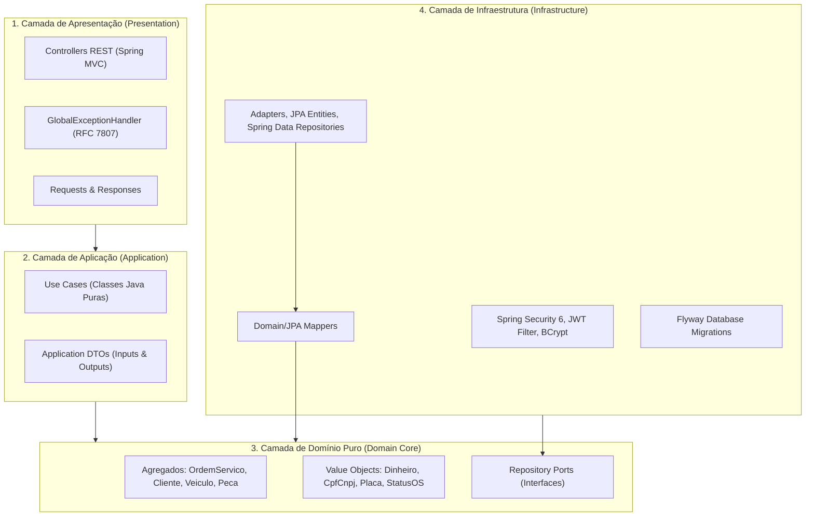

# Tech Challenge SOAT - Fase 1: Sistema de Gestão de Oficina Mecânica

Sistema desenvolvido para atender aos requisitos da **Fase 1 do Tech Challenge da Pós-Graduação em Software Architecture (SOAT) da FIAP**.

O projeto consiste em uma API RESTful de alta performance e robustez arquitetural para a gestão completa de uma oficina mecânica, contemplando o cadastro de clientes, gestão de veículos, catálogo e controle físico de estoque de peças, fluxo de ordens de serviço orquestrado por máquina de estados e cálculo de métricas operacionais de atendimento.

---

## Sumário

1. [Objetivo](#1-objetivo)
2. [Descrição da Solução](#2-descrição-da-solução)
3. [Arquitetura (Clean Architecture Monolítica)](#3-arquitetura-clean-architecture-monolítica)
4. [Tecnologias Utilizadas](#4-tecnologias-utilizadas)
5. [Pré-requisitos](#5-pré-requisitos)
6. [Instruções de Execução](#6-instruções-de-execução)
7. [Instruções para Execução dos Testes Automatizados](#7-instruções-para-execução-dos-testes-automatizados)
8. [Acesso ao Swagger e Documentação da API](#8-acesso-ao-swagger-e-documentação-da-api)
9. [Decisão e Justificativa do Banco de Dados PostgreSQL](#9-decisão-e-justificativa-do-banco-de-dados-postgresql)
10. [Usuários e Credenciais de Demonstração](#10-usuários-e-credenciais-de-demonstração)
11. [Estrutura de Diretórios do Projeto](#11-estrutura-de-diretórios-do-projeto)
12. [Documentação DDD e Artefatos Arquiteturais](#12-documentação-ddd-e-artefatos-arquiteturais)
13. [Link do Vídeo Demonstrativo](#13-link-do-vídeo-demonstrativo)

---

## 1. Objetivo

Implementar uma solução de software escalável, sustentável e rigorosamente alinhada às melhores práticas da engenharia de software contemporânea:
- Aplicação estrita dos princípios de **Domain-Driven Design (DDD)** para mapeamento de linguagem ubíqua e invariantes de negócio.
- Isolamento absoluto da camada de domínio em relação a frameworks e bancos de dados (**Clean Architecture**).
- Garantia de qualidade atestada por cobertura de testes automatizados superior a **80%** (com meta JaCoCo atingida de **>95% em linhas** e **>85% em branches**).
- Empacotamento conteinerizado pronto para execução em qualquer ambiente via **Docker** e **Docker Compose**.

---

## 2. Descrição da Solução

O sistema provê suporte aos processos essenciais da operação de uma oficina automotiva:
* **Gestão de Clientes e Veículos:** Cadastro de pessoas físicas e jurídicas (validação matemática estrita de CPF/CNPJ), associação de veículos com validação de placa tradicional (`ABC-1234`) e Mercosul (`ABC1D23`), e garantia de que o veículo vinculado a uma Ordem de Serviço pertença obrigatoriamente ao cliente solicitante.
* **Controle de Catálogo e Inventário:** Registro de peças com controle de saldo de estoque, estoque mínimo e preço unitário. O sistema impede que o saldo fique negativo e emite alertas quando peças estão abaixo do limite operacional de segurança.
* **Máquina de Estados Finita da Ordem de Serviço (OS):**
  $$\text{RECEBIDA} \longrightarrow \text{EM\_DIAGNOSTICO} \longrightarrow \text{AGUARDANDO\_APROVACAO} \longrightarrow \text{EM\_EXECUCAO} \longrightarrow \text{FINALIZADA} \longrightarrow \text{ENTREGUE}$$
  - Permite adição e remoção de serviços e peças durante o diagnóstico técnico.
  - Bloqueia modificações de itens após submissão do orçamento.
  - Disponibiliza endpoint público para o cliente consultar o orçamento sem autenticação e aprovar a execução dos reparos.
  - Efetua a baixa física automática de cada peça no inventário no exato momento da aprovação pelo cliente.
* **Métricas Operacionais:** Cálculo em tempo real do **tempo médio de execução** das manutenções, computando a duração entre a abertura (`dataAbertura`) e o encerramento técnico (`dataFinalizacao`) de ordens finalizadas.

---

## 3. Arquitetura (Clean Architecture Monolítica)

A solução foi concebida como um **Monólito Modular** baseado na **Clean Architecture** (Arquitetura Limpa / Hexagonal):



### Princípios Aplicados:
* **Regra de Dependência:** As dependências do código apontam exclusivamente para o interior do sistema. A camada `domain` possui **zero dependências** de bibliotecas externas, Spring, JPA ou Hibernate.
* **Use Cases Puros:** Todos os casos de uso são classes Java convencionais (POJOs), desprovidos de anotações `@Service` ou `@Component`, garantindo que a lógica de aplicação não dependa de contêineres de injeção de dependência.
* **Tratamento de Exceções Padronizado (RFC 7807):** Toda exceção de negócio ou validação retorna payload estruturado do tipo `application/problem+json` (*ProblemDetail*).

---

## 4. Tecnologias Utilizadas

* **Linguagem:** Java 21 LTS (Records, Pattern Matching, Sealed Types, Virtual Threads ready).
* **Framework:** Spring Boot 3.3.4 (Spring MVC, Spring Data JPA, Spring Security 6, Spring Validation).
* **Segurança:** JJWT 0.12.6 (*io.jsonwebtoken*) com assinatura HMAC-SHA256 e senhas em BCrypt.
* **Banco de Dados Relacional:** PostgreSQL 16 Alpine com migrações versionadas via Flyway 10.
* **Documentação de API:** Springdoc OpenAPI 2.6.0 (Swagger UI / OpenAPI 3).
* **Testes e Cobertura:** JUnit 5, Mockito, AssertJ, Spring Test, Banco H2 (escopo de teste) e JaCoCo 0.8.12.
* **Conteinerização:** Docker com build multi-stage e Docker Compose.

---

## 5. Pré-requisitos

Para executar a aplicação e seus testes automatizados, certifique-se de possuir em seu ambiente:
* **Git** (para clonagem do repositório).
* **Docker** (versão 24+) e **Docker Compose** (versão 2+).
* *(Opcional)* **JDK 21** e **Apache Maven 3.9+** (caso deseje executar localmente sem utilizar os contêineres Docker).

---

## 6. Instruções de Execução

A maneira recomendada e homologada para subir a aplicação completa e seu banco de dados é via **Docker Compose**:

### 6.1 Subindo os Contêineres:
Na raiz do projeto, execute:
```bash
docker compose up -d --build
```

O comando irá:
1. Provisionar o contêiner `postgres` (PostgreSQL 16) com volume persistente e aguardar a inicialização saudável via *healthcheck* (`pg_isready`).
2. Executar o multi-stage build do contêiner `api`, compilando o código em imagem Java 21 leve (`eclipse-temurin:21-jre-alpine`) e iniciando o serviço com usuário não-root.
3. Executar as migrações automáticas do Flyway na inicialização do Spring Boot.

### 6.2 Verificando os Logs de Inicialização:
```bash
docker compose logs -f api
```

### 6.3 Parando os Contêineres:
```bash
docker compose down
```

---

## 7. Instruções para Execução dos Testes Automatizados

O projeto conta com mais de 220 testes unitários e de integração de ponta a ponta. O plugin **JaCoCo** está configurado na fase `verify` com validação de cobertura mínima estrita de **80%** para linhas e branches.

### Executando no Ambiente com Maven Instalado:
```bash
mvn clean verify
```

### Executando em Ambiente Isolado via Contêiner Docker:
Caso você não possua Java 21 ou Maven instalados em sua máquina host, execute o comando abaixo (compatível com Linux/WSL2 e Windows):
```bash
docker run --rm -v $(pwd):/app -w /app maven:3.9.8-eclipse-temurin-21 mvn clean verify
```

### Relatório de Cobertura JaCoCo:
Após a execução do build, o relatório HTML pode ser aberto em seu navegador no caminho:
```text
target/site/jacoco/index.html
```

**Métricas Atingidas:**
* **Cobertura de Linhas (Line Coverage):** **95.57%** (meta: $\ge 80\%$)
* **Cobertura de Decisões (Branch Coverage):** **85.23%** (meta: $\ge 80\%$)
* **Total de Testes:** 227 testes (0 falhas, 0 erros, 0 ignorados).

---

## 8. Acesso ao Swagger e Documentação da API

Com a aplicação em execução (`docker compose up`), a documentação interativa OpenAPI 3 / Swagger UI estará disponível em:

* **Swagger UI:** [http://localhost:8080/swagger-ui/index.html](http://localhost:8080/swagger-ui/index.html)
* **OpenAPI Spec (JSON):** [http://localhost:8080/v3/api-docs](http://localhost:8080/v3/api-docs)

> **Dica de Uso:** Para testar endpoints administrativos e operacionais no Swagger, utilize o botão **Authorize** informando o token retornado pelo endpoint `POST /api/v1/auth/login`.

---

## 9. Decisão e Justificativa do Banco de Dados PostgreSQL

A escolha do **PostgreSQL 16** como banco de dados principal do sistema baseia-se em decisões técnicas e de negócio fundamentais:

1. **Transações ACID Estritas:** A operação de aprovação de orçamento de uma Ordem de Serviço exige atomicidade absoluta: o status da OS deve transicionar para `EM_EXECUCAO` simultaneamente ao débito das unidades de cada peça física no inventário. O PostgreSQL garante que nenhuma peça seja baixada isoladamente caso ocorra qualquer inconsistência.
2. **Prevenção de Inconsistências Concorrentes no Estoque:** A existência de restrições em nível de tabela (`CHECK (saldo_estoque >= 0)`) associada ao controle transacional do PostgreSQL impede fisicamente a geração de estoques negativos ou condições de corrida sob alta concorrência.
3. **Precisão Numérica Financeira:** Utilização nativa do tipo `NUMERIC(12, 2)` para evitar imprecisões de arredondamento em cálculos de orçamento.
4. **Integridade Referencial Rigorosa:** Chaves estrangeiras com `ON DELETE RESTRICT` garantem que clientes ou veículos não sejam excluídos acidentalmente caso possuam ordens de serviço ativas.
5. **Identificadores Criptográficos Universais:** Utilização do tipo `UUID` com `DEFAULT gen_random_uuid()` para chaves primárias, garantindo não-previsibilidade dos identificadores nas URLs da API.

Consulte a íntegra no documento [ADR-002: Escolha do Banco de Dados Relacional PostgreSQL 16](docs/architecture/adrs/ADR-002-banco-de-dados-postgresql.md).

---

## 10. Usuários e Credenciais de Demonstração

Para fins de avaliação, testes de integração e demonstração no Swagger, o sistema já é inicializado com dois perfis de acesso pré-configurados:

| Usuário | Senha | Papel (Role) | Permissões / Escopo |
| :--- | :--- | :--- | :--- |
| `admin` | `admin123` | `ROLE_ADMIN` | Acesso total: gestão de clientes, veículos, catálogo de peças e **consulta de métricas de tempo médio** (`/api/v1/ordens-servico/metricas/**`). |
| `mecanico` | `mecanico123` | `ROLE_MECANICO` | Operacional: abertura de OS, início de diagnóstico, adição/remoção de peças e serviços, finalização técnica e entrega. |

### Como Autenticar:
Envie uma requisição `POST /api/v1/auth/login`:
```json
{
  "username": "admin",
  "password": "admin123"
}
```
O retorno conterá o token Bearer no campo `token`. Inclua-o no cabeçalho `Authorization: Bearer <seu_token>` nas chamadas subsequentes.

---

## 11. Estrutura de Diretórios do Projeto

A organização de pastas reflete rigorosamente os preceitos da Clean Architecture:

```text
oficina-mecanica/
├── Dockerfile
├── docker-compose.yml
├── pom.xml
├── README.md
├── docs/
│   ├── ddd/
│   │   ├── linguagem-ubiqua.md            # Glossário formal de termos e anti-glossário
│   │   └── event-storming.md              # Notação de cores e fluxos do Event Storming
│   └── architecture/
│       ├── c4-model.md                    # Níveis 1, 2 e 3 do Modelo C4
│       └── adrs/
│           ├── ADR-001-clean-architecture-monolith.md
│           ├── ADR-002-banco-de-dados-postgresql.md
│           └── ADR-003-autenticacao-jwt.md
└── src/
    ├── main/
    │   ├── java/br/com/fiap/soat/oficina/
    │   │   ├── domain/                    # 1. Domínio Puro (Sem Frameworks)
    │   │   │   ├── entity/                # Entidades e Agregados
    │   │   │   ├── exception/             # Exceções de Domínio
    │   │   │   ├── repository/            # Interfaces de Repositório (Ports)
    │   │   │   └── valueobject/           # Records imutáveis (Dinheiro, Placa, CpfCnpj, StatusOS)
    │   │   ├── application/               # 2. Casos de Uso (Application POJOs)
    │   │   │   ├── dto/                   # Inputs e Outputs
    │   │   │   └── usecase/               # Use Cases organizados por contexto
    │   │   ├── presentation/              # 3. Apresentação (REST Controllers)
    │   │   │   ├── controller/            # Controllers Spring MVC
    │   │   │   ├── handler/               # GlobalExceptionHandler (RFC 7807)
    │   │   │   ├── request/               # Payloads com Jakarta Validation
    │   │   │   └── response/              # Payloads de retorno
    │   │   └── infrastructure/            # 4. Infraestrutura
    │   │       ├── config/                # Bean Configs, SecurityConfig, OpenApiConfig
    │   │       ├── persistence/           # JPA Entities, Mappers e Adapters
    │   │       └── security/              # JwtService, JwtFilter, CustomUserDetailsService
    │   └── resources/
    │       ├── application.yml
    │       └── db/migration/
    │           └── V1__init_schema.sql    # DDL inicial versionado pelo Flyway
    └── test/
        ├── java/br/com/fiap/soat/oficina/ # Suíte de testes unitários e de integração (>95% cobertura)
        └── resources/
            └── application-test.yml       # Configurações do perfil H2 para testes
```

---

## 12. Documentação DDD e Artefatos Arquiteturais

A documentação analítica de arquitetura e design de software encontra-se versionada no repositório:

* 📖 **[Linguagem Ubíqua (Glossário e Anti-Glossário)](docs/ddd/linguagem-ubiqua.md):** Definição semântica formal dos termos de negócio e conceitos evitados.
* ⚡ **[Event Storming](docs/ddd/event-storming.md):** Mapeamento cronológico dos 3 fluxos críticos com eventos, comandos, atores, agregados e políticas.
* 🏛️ **[Modelo C4 (Contexto, Contêineres e Componentes)](docs/architecture/c4-model.md):** Diagramas conceituais dos níveis 1, 2 e 3.
* 📋 **[Requisitos Não Funcionais (DEUS / DOA / LER)](docs/architecture/requisitos-nao-funcionais.md):** Classificação em Produto, Organizacional e Externo com evidências no código.
* 📜 **Architecture Decision Records (ADRs):**
  - [ADR-001: Clean Architecture em Monólito Modular](docs/architecture/adrs/ADR-001-clean-architecture-monolith.md)
  - [ADR-002: Banco de Dados Relacional PostgreSQL 16 com Transações ACID](docs/architecture/adrs/ADR-002-banco-de-dados-postgresql.md)
  - [ADR-003: Autenticação Stateless baseada em JWT e RBAC](docs/architecture/adrs/ADR-003-autenticacao-jwt.md)

---

## 13. Link do Vídeo Demonstrativo

Conforme exigido no edital da Fase 1, foi gravado um vídeo demonstrativo detalhando a arquitetura, o desenho DDD, a execução dos testes automatizados e o funcionamento da API via Swagger:

* 🎥 **Link do Vídeo no YouTube:** [https://www.youtube.com/watch?v=SUBSTITUIR_LINK_DO_VIDEO](https://www.youtube.com/watch?v=SUBSTITUIR_LINK_DO_VIDEO)

