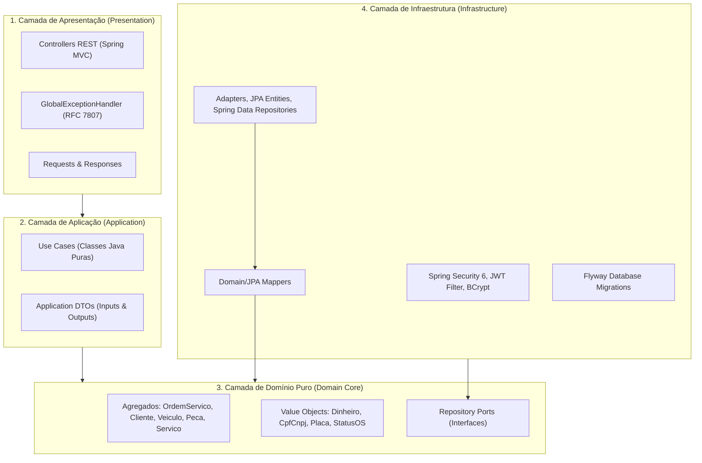

# Tech Challenge SOAT - Fase 1: Sistema de Gestão de Oficina Mecânica

Projeto da **Fase 1 do Tech Challenge da Pós-Graduação em Software Architecture (SOAT) da FIAP**.

API RESTful para gestão de uma oficina mecânica, contemplando cadastro de clientes, gestão de veículos, catálogo de serviços, controle de estoque de peças, fluxo de ordens de serviço com máquina de estados e cálculo do tempo médio de execução.

---

## Sumário

1. [Objetivo](#1-objetivo)
2. [Descrição da Solução](#2-descrição-da-solução)
3. [Arquitetura (Clean Architecture Monolítica)](#3-arquitetura-clean-architecture-monolítica)
4. [Tecnologias Utilizadas](#4-tecnologias-utilizadas)
5. [Pré-requisitos](#5-pré-requisitos)
6. [Instruções de Execução](#6-instruções-de-execução)
7. [Instruções para Execução dos Testes Automatizados](#7-instruções-para-execução-dos-testes-automatizados)
8. [Acesso ao Swagger e Documentação da API](#8-acesso-ao-swagger-e-documentação-da-api)
9. [Decisão e Justificativa do Banco de Dados PostgreSQL](#9-decisão-e-justificativa-do-banco-de-dados-postgresql)
10. [Usuários e Credenciais de Demonstração](#10-usuários-e-credenciais-de-demonstração)
11. [Estrutura de Diretórios do Projeto](#11-estrutura-de-diretórios-do-projeto)
12. [Documentação DDD, Arquitetura e Segurança](#12-documentação-ddd-arquitetura-e-segurança)
13. [Link do Vídeo Demonstrativo](#13-link-do-vídeo-demonstrativo)

---

## 1. Objetivo

Desenvolver o backend de gestão da oficina mecânica aplicando:
- **Domain-Driven Design (DDD)** para modelagem da linguagem ubíqua, agregados e regras de negócio.
- **Clean Architecture** com camada de domínio desacoplada de frameworks e banco de dados.
- **Testes automatizados** unitários e de integração (meta JaCoCo atingida de **96.77% em linhas** e **83.54% em branches**).
- **Docker** e **Docker Compose** para execução padronizada da API e do banco de dados.

---

## 2. Descrição da Solução

O sistema cobre os processos operacionais da oficina automotiva:
* **Gestão de Clientes e Veículos:** Cadastro, consulta por ID/CPF/CNPJ/Placa, atualização e remoção de clientes (pessoas físicas e jurídicas com validação dos dígitos verificadores) e veículos (validação de placa tradicional `ABC-1234` e Mercosul `ABC1D23`), garantindo que o veículo vinculado a uma Ordem de Serviço pertença ao cliente solicitante.
* **Catálogo de Serviços e Controle de Peças/Insumos (CRUD Completo + Estoque):**
  - **Catálogo de Serviços (`/api/v1/servicos`):** CRUD completo de serviços padronizados da oficina (código único, nome, descrição e valor unitário de mão de obra).
  - **Peças e Insumos (`/api/v1/pecas`):** CRUD completo de peças com controle físico de saldo de estoque, estoque mínimo e valor unitário. O sistema impede saldos negativos e emite alertas quando peças estão abaixo do limite operacional de segurança.
* **Máquina de Estados Finita da Ordem de Serviço (OS):**
  Orquestração estrita de ciclo de vida com transições unidirecionais controladas:

  `RECEBIDA` ➔ `EM_DIAGNOSTICO` ➔ `AGUARDANDO_APROVACAO` ➔ `EM_EXECUCAO` ➔ `FINALIZADA` ➔ `ENTREGUE`
  *(com possibilidade de transição para `CANCELADA` por cancelamento ou rejeição do orçamento)*

  ```mermaid
  stateDiagram-v2
      direction LR
      [*] --> RECEBIDA
      RECEBIDA --> EM_DIAGNOSTICO: Iniciar Diagnóstico
      EM_DIAGNOSTICO --> AGUARDANDO_APROVACAO: Submeter Orçamento
      AGUARDANDO_APROVACAO --> EM_EXECUCAO: Aprovar Orçamento (Baixa Estoque)
      AGUARDANDO_APROVACAO --> CANCELADA: Rejeitar Orçamento / Cancelar
      EM_EXECUCAO --> FINALIZADA: Finalizar Execução
      FINALIZADA --> ENTREGUE: Registrar Entrega
      ENTREGUE --> [*]

      RECEBIDA --> CANCELADA: Cancelar
      EM_DIAGNOSTICO --> CANCELADA: Cancelar
      CANCELADA --> [*]
  ```

  - Permite adição e remoção de serviços (via catálogo `servicoId` ou avulsos) e peças durante o diagnóstico técnico (`EM_DIAGNOSTICO`).
  - Bloqueia modificações de itens após submissão do orçamento (`AGUARDANDO_APROVACAO`).
  - Disponibiliza endpoints públicos (`/api/v1/public/ordens-servico/{id}/**`) para o cliente consultar o orçamento detalhado sem exposição de dados sensíveis (LGPD), bem como **aprovar** ou **rejeitar** o orçamento.
  - Efetua a baixa física automática e atômica (`@Transactional`) de cada peça no inventário no exato momento da aprovação pelo cliente.
* **Métricas Operacionais:** Cálculo em tempo real do **tempo médio de execução** dos serviços (`GET /api/v1/ordens-servico/metricas/tempo-medio`), computando a duração $\Delta t = \text{dataFinalizacao} - \text{dataAprovacao}$ das ordens concluídas (`FINALIZADA` e `ENTREGUE`).

---

## 3. Arquitetura (Clean Architecture Monolítica)

A solução foi concebida como um **Monólito Modular** baseado na **Clean Architecture** (Arquitetura Limpa / Hexagonal):



### Princípios Aplicados:
* **Regra de Dependência:** As dependências do código apontam exclusivamente para o interior do sistema. A camada `domain` possui **zero dependências** de bibliotecas externas, Spring, JPA ou Hibernate.
* **Use Cases Puros:** Todos os casos de uso são classes Java convencionais (POJOs), desprovidos de anotações `@Service` ou `@Component`, garantindo que a lógica de aplicação não dependa de contêineres de injeção de dependência.
* **Tratamento de Exceções Padronizado (RFC 7807):** Toda exceção de negócio ou validação retorna payload estruturado do tipo `application/problem+json` (*ProblemDetail*).

---

## 4. Tecnologias Utilizadas

* **Linguagem:** Java 21 LTS (Records, Pattern Matching, Sealed Types, Virtual Threads ready).
* **Framework:** Spring Boot 3.3.4 (Spring MVC, Spring Data JPA, Spring Security 6, Spring Validation).
* **Segurança:** JJWT 0.12.6 (*io.jsonwebtoken*) com assinatura HMAC-SHA256 e senhas em BCrypt.
* **Banco de Dados Relacional:** PostgreSQL 16 Alpine com migrações versionadas via Flyway 10.
* **Documentação de API:** Springdoc OpenAPI 2.6.0 (Swagger UI / OpenAPI 3).
* **Testes e Cobertura:** JUnit 5, Mockito, AssertJ, Spring Test, Banco H2 (escopo de teste) e JaCoCo 0.8.12.
* **Conteinerização:** Docker com build multi-stage e Docker Compose.

---

## 5. Pré-requisitos

Para executar a aplicação e seus testes automatizados, certifique-se de possuir em seu ambiente:
* **Git** (para clonagem do repositório).
* **Docker** (versão 24+) e **Docker Compose** (versão 2+).
* *(Opcional)* **JDK 21** e **Apache Maven 3.9+** (caso deseje executar localmente sem utilizar os contêineres Docker).

---

## 6. Instruções de Execução

A maneira recomendada e homologada para subir a aplicação completa e seu banco de dados é via **Docker Compose**:

### 6.1 Subindo os Contêineres:
Na raiz do projeto, execute:
```bash
docker compose up -d --build
```

O comando irá:
1. Provisionar o contêiner `postgres` (PostgreSQL 16) com volume persistente e aguardar a inicialização saudável via *healthcheck* (`pg_isready`).
2. Executar o multi-stage build do contêiner `api`, compilando o código em imagem Java 21 leve (`eclipse-temurin:21-jre-alpine`) e iniciando o serviço com usuário não-root.
3. Executar as migrações automáticas do Flyway na inicialização do Spring Boot.

### 6.2 Verificando os Logs de Inicialização:
```bash
docker compose logs -f api
```

### 6.3 Parando os Contêineres:
```bash
docker compose down
```

---

## 7. Instruções para Execução dos Testes Automatizados

O projeto conta com **251 testes unitários e de integração de ponta a ponta**. O plugin **JaCoCo** está configurado na fase `verify` com validação de cobertura mínima estrita de **80%** para linhas e branches.

### Executando no Ambiente com Maven Instalado:
```bash
mvn clean verify
```

### Executando em Ambiente Isolado via Contêiner Docker:
Caso você não possua Java 21 ou Maven instalados em sua máquina host, execute o comando abaixo (compatível com Linux/WSL2 e Windows):
```bash
docker run --rm -v $(pwd):/app -w /app maven:3.9.8-eclipse-temurin-21 mvn clean verify
```

### Relatório de Cobertura JaCoCo:
Após a execução do build, o relatório HTML pode ser aberto em seu navegador no caminho:
```text
target/site/jacoco/index.html
```

**Métricas Atingidas:**
* **Cobertura de Linhas (Line Coverage):** **96.77%** (meta: ≥ 80%)
* **Cobertura de Decisões (Branch Coverage):** **83.54%** (meta: ≥ 80%)
* **Cobertura de Entidades de Domínio (`domain.entity`):** **98.77%** de linhas e **90.40%** de branches
* **Total de Testes:** **251 testes** (0 falhas, 0 erros, 0 ignorados).

---

## 8. Acesso ao Swagger e Principais Endpoints da API

Com a aplicação em execução (`docker compose up`), a documentação interativa OpenAPI 3 / Swagger UI estará disponível em:

* **Swagger UI:** [http://localhost:8080/swagger-ui/index.html](http://localhost:8080/swagger-ui/index.html)
* **OpenAPI Spec (JSON):** [http://localhost:8080/v3/api-docs](http://localhost:8080/v3/api-docs)

> **Dica de Uso:** Para testar endpoints administrativos e operacionais no Swagger, utilize o botão **Authorize** informando o token retornado pelo endpoint `POST /api/v1/auth/login`.

### Resumo dos Contratos RESTful:

| Contexto | Método e Endpoint | Acesso | Descrição |
| :--- | :--- | :---: | :--- |
| **Autenticação** | `POST /api/v1/auth/login` | Público | Emite token Bearer JWT (`ROLE_ADMIN` ou `ROLE_MECANICO`). |
| **Clientes (CRUD)** | `POST`, `GET`, `PUT`, `DELETE /api/v1/clientes/**`<br>`GET /api/v1/clientes/documento/{documento}` | JWT | Cadastro, listagem, busca por ID ou CPF/CNPJ, atualização e exclusão. |
| **Veículos (CRUD)** | `POST`, `GET`, `PUT`, `DELETE /api/v1/veiculos/**`<br>`GET /api/v1/veiculos/placa/{placa}`<br>`GET /api/v1/veiculos/cliente/{clienteId}` | JWT | Cadastro, listagem geral/por cliente, busca por placa, atualização e exclusão. |
| **Catálogo de Serviços (CRUD)** | `POST`, `GET`, `PUT`, `DELETE /api/v1/servicos/**`<br>`GET /api/v1/servicos/codigo/{codigo}` | JWT | CRUD completo de serviços padronizados da oficina. |
| **Peças e Estoque (CRUD)** | `POST`, `GET`, `PUT`, `DELETE /api/v1/pecas/**`<br>`PATCH /api/v1/pecas/{id}/repor-estoque`<br>`PATCH /api/v1/pecas/{id}/debitar-estoque`<br>`GET /api/v1/pecas/abaixo-minimo` | JWT | CRUD de peças/insumos, reposição/baixa avulsa de saldo e alerta de estoque crítico. |
| **Ordens de Serviço (Admin)** | `POST`, `GET /api/v1/ordens-servico/**`<br>`POST /api/v1/ordens-servico/{id}/iniciar-diagnostico`<br>`PATCH /api/v1/ordens-servico/{id}/diagnostico`<br>`POST /api/v1/ordens-servico/{id}/itens/servicos`<br>`DELETE /api/v1/ordens-servico/{id}/itens/servicos/{itemId}`<br>`POST /api/v1/ordens-servico/{id}/itens/pecas`<br>`DELETE /api/v1/ordens-servico/{id}/itens/pecas/{itemId}`<br>`POST /api/v1/ordens-servico/{id}/submeter-aprovacao`<br>`POST /api/v1/ordens-servico/{id}/aprovar`<br>`POST /api/v1/ordens-servico/{id}/rejeitar`<br>`POST /api/v1/ordens-servico/{id}/finalizar`<br>`POST /api/v1/ordens-servico/{id}/entregar`<br>`POST /api/v1/ordens-servico/{id}/cancelar` | JWT | Ciclo completo de criação, diagnóstico, inclusão/remoção de serviços e peças, orçamento, aprovação/rejeição, finalização e entrega. |
| **Métricas Operacionais** | `GET /api/v1/ordens-servico/metricas/tempo-medio` | JWT (`ADMIN`) | Monitoramento do tempo médio de execução ($\text{dataFinalizacao} - \text{dataAprovacao}$). |
| **Acompanhamento do Cliente (Público)** | `GET /api/v1/public/ordens-servico/{id}/status`<br>`POST /api/v1/public/ordens-servico/{id}/aprovar`<br>`POST /api/v1/public/ordens-servico/{id}/rejeitar` | Público | Consulta de progresso e orçamento pelo cliente (LGPD-safe), aprovação e rejeição. |

---

## 9. Decisão e Justificativa do Banco de Dados PostgreSQL

A escolha do **PostgreSQL 16** como banco de dados principal do sistema baseia-se em decisões técnicas e de negócio fundamentais:

1. **Transações ACID Estritas:** A operação de aprovação de orçamento de uma Ordem de Serviço exige atomicidade absoluta: o status da OS deve transicionar para `EM_EXECUCAO` simultaneamente ao débito das unidades de cada peça física no inventário. O PostgreSQL garante que nenhuma peça seja baixada isoladamente caso ocorra qualquer inconsistência.
2. **Prevenção de Inconsistências Concorrentes no Estoque:** A existência de restrições em nível de tabela (`CHECK (saldo_estoque >= 0)`) associada ao controle transacional do PostgreSQL impede fisicamente a geração de estoques negativos ou condições de corrida sob alta concorrência.
3. **Precisão Numérica Financeira:** Utilização nativa do tipo `NUMERIC(12, 2)` para evitar imprecisões de arredondamento em cálculos de orçamento.
4. **Integridade Referencial Rigorosa:** Chaves estrangeiras com `ON DELETE RESTRICT` garantem que clientes ou veículos não sejam excluídos acidentalmente caso possuam ordens de serviço ativas.
5. **Identificadores Criptográficos Universais:** Utilização do tipo `UUID` com `DEFAULT gen_random_uuid()` para chaves primárias, garantindo não-previsibilidade dos identificadores nas URLs da API.

Consulte a íntegra no documento [ADR-002: Escolha do Banco de Dados Relacional PostgreSQL 16](docs/architecture/adrs/ADR-002-banco-de-dados-postgresql.md).

---

## 10. Usuários e Credenciais de Demonstração

Para fins de avaliação, testes de integração e demonstração no Swagger, o sistema já é inicializado com dois perfis de acesso pré-configurados:

| Usuário | Senha | Papel (Role) | Permissões / Escopo |
| :--- | :--- | :--- | :--- |
| `admin` | `admin123` | `ROLE_ADMIN` | Acesso total: gestão de clientes, veículos, catálogo de serviços e peças, ordens de serviço e **consulta de métricas de tempo médio** (`/api/v1/ordens-servico/metricas/**`). |
| `mecanico` | `mecanico123` | `ROLE_MECANICO` | Operacional: abertura de OS, início de diagnóstico, adição/remoção de peças e serviços, finalização técnica e entrega. |

### Como Autenticar:
Envie uma requisição `POST /api/v1/auth/login`:
```json
{
  "username": "admin",
  "password": "admin123"
}
```
O retorno conterá o token Bearer no campo `token`. Inclua-o no cabeçalho `Authorization: Bearer <seu_token>` nas chamadas subsequentes.

---

## 11. Estrutura de Diretórios do Projeto

A organização de pastas reflete rigorosamente os preceitos da Clean Architecture:

```text
oficina-mecanica/
├── Dockerfile
├── docker-compose.yml
├── pom.xml
├── README.md
├── docs/
│   ├── ddd/
│   │   ├── linguagem-ubiqua.md            # Glossário de termos, Bounded Contexts e rastreabilidade
│   │   ├── event-storming.md              # Event Storming dos fluxos do domínio (Markdown)
│   │   ├── event-storming.pdf             # Event Storming em PDF
│   │   ├── diagramas.md                   # Diagramas estratégicos, táticos, sequência e DER (Markdown)
│   │   └── diagramas.pdf                  # Diagramas DDD e C4 em PDF
│   ├── security/
│   │   ├── relatorio-vulnerabilidades.md  # Relatório de análise de vulnerabilidades (SCA, SAST, Docker, OWASP)
│   │   ├── relatorio-vulnerabilidades.pdf # Relatório de vulnerabilidades em PDF
│   │   ├── relatorio-sonarqube.md         # Relatório de Qualidade e Segurança Estática (SonarQube & JaCoCo)
│   │   └── relatorio-sonarqube.pdf        # Relatório do SonarQube em PDF (com Dashboard Quality Gate)
│   └── architecture/
│       ├── c4-model.md                    # Modelo C4 da Arquitetura
│       ├── requisitos-nao-funcionais.md   # Requisitos Não Funcionais (DEUS / DOA / LER)
│       └── adrs/
│           ├── ADR-001-clean-architecture-monolith.md
│           ├── ADR-002-banco-de-dados-postgresql.md
│           └── ADR-003-autenticacao-jwt.md
└── src/
    ├── main/
    │   ├── java/br/com/fiap/soat/oficina/
    │   │   ├── domain/                    # 1. Domínio Puro (Sem Frameworks)
    │   │   │   ├── entity/                # Entidades e Agregados (OrdemServico, Cliente, Veiculo, Peca, Servico)
    │   │   │   ├── exception/             # Exceções de Domínio
    │   │   │   ├── repository/            # Interfaces de Repositório (Ports)
    │   │   │   └── valueobject/           # Records imutáveis (Dinheiro, Placa, CpfCnpj, StatusOS)
    │   │   ├── application/               # 2. Casos de Uso (Application POJOs)
    │   │   │   ├── dto/                   # Inputs e Outputs
    │   │   │   └── usecase/               # Use Cases organizados por contexto (os, cliente, veiculo, peca, servico)
    │   │   ├── presentation/              # 3. Apresentação (REST Controllers)
    │   │   │   ├── controller/            # Controllers Spring MVC
    │   │   │   ├── handler/               # GlobalExceptionHandler (RFC 7807)
    │   │   │   ├── request/               # Payloads com Jakarta Validation
    │   │   │   └── response/              # Payloads de retorno
    │   │   └── infrastructure/            # 4. Infraestrutura
    │   │       ├── config/                # Bean Configs, SecurityConfig, OpenApiConfig
    │   │       ├── persistence/           # JPA Entities, Mappers e Adapters
    │   │       └── security/              # JwtService, JwtFilter, CustomUserDetailsService
    │   └── resources/
    │       ├── application.yml
    │       └── db/migration/
    │           └── V1__init_schema.sql    # DDL inicial versionado pelo Flyway
    └── test/
        ├── java/br/com/fiap/soat/oficina/ # Suíte de 251 testes unitários e de integração (>96% cobertura)
        └── resources/
            └── application-test.yml       # Configurações do perfil H2 para testes
```

---

## 12. Documentação DDD, Arquitetura e Segurança

A documentação de arquitetura, DDD e segurança está versionada no repositório:

* 🎨 **Quadro Miro:** [https://miro.com/app/board/uXjVETBYsng=/?share_link_id=296220385966](https://miro.com/app/board/uXjVETBYsng=/?share_link_id=296220385966)
* 📖 **[Linguagem Ubíqua, Bounded Contexts e Rastreabilidade](docs/ddd/linguagem-ubiqua.md)**
* ⚡ **[Event Storming (Markdown)](docs/ddd/event-storming.md)** | **[Event Storming (PDF)](docs/ddd/event-storming.pdf)**
* 📐 **[Diagramas DDD e Arquitetura (Markdown)](docs/ddd/diagramas.md)** | **[Diagramas DDD (PDF)](docs/ddd/diagramas.pdf)**
* 🛡️ **[Relatório de Análise de Vulnerabilidades — OWASP/SCA/Container (Markdown)](docs/security/relatorio-vulnerabilidades.md)** | **[Relatório (PDF)](docs/security/relatorio-vulnerabilidades.pdf)**
* 📊 **[Relatório de Qualidade e Segurança Estática — SonarQube & JaCoCo (Markdown)](docs/security/relatorio-sonarqube.md)** | **[Relatório SonarQube (PDF)](docs/security/relatorio-sonarqube.pdf)**
* 🏛️ **[Modelo C4 (Contexto, Contêineres e Componentes)](docs/architecture/c4-model.md)**
* 📋 **[Requisitos Não Funcionais (DEUS / DOA / LER)](docs/architecture/requisitos-nao-funcionais.md)**
* 📜 **Architecture Decision Records (ADRs):**
  - [ADR-001: Clean Architecture em Monólito Modular](docs/architecture/adrs/ADR-001-clean-architecture-monolith.md)
  - [ADR-002: Banco de Dados Relacional PostgreSQL 16 com Transações ACID](docs/architecture/adrs/ADR-002-banco-de-dados-postgresql.md)
  - [ADR-003: Autenticação Stateless baseada em JWT e RBAC](docs/architecture/adrs/ADR-003-autenticacao-jwt.md)

---

## 13. Link do Vídeo Demonstrativo

Vídeo de apresentação da arquitetura, modelagem DDD, testes automatizados e demonstração da API:

* 🎥 **Link do Vídeo no YouTube:** [https://www.youtube.com/watch?v=SUBSTITUIR_LINK_DO_VIDEO](https://www.youtube.com/watch?v=SUBSTITUIR_LINK_DO_VIDEO)


