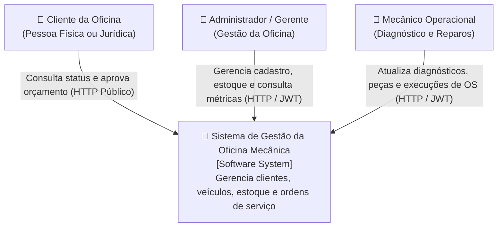
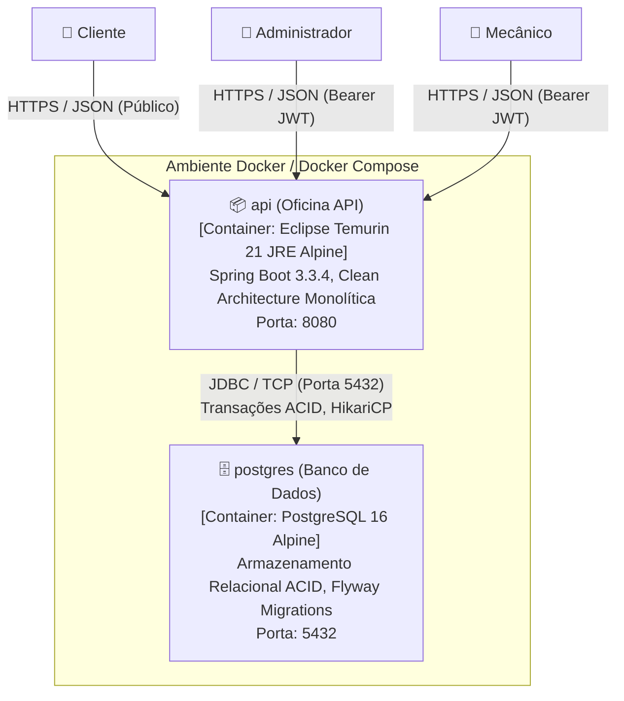
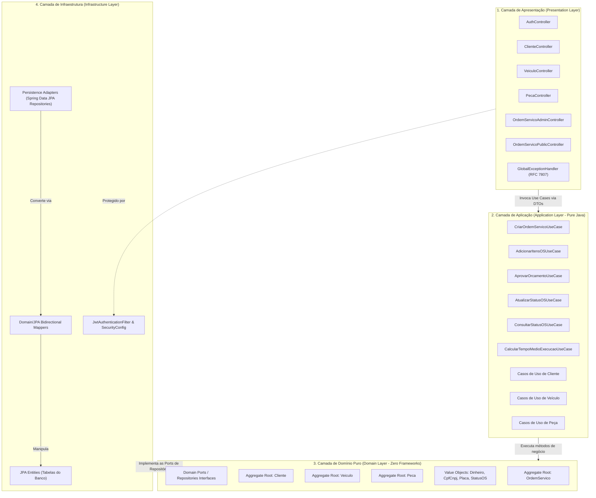

# Modelo C4 (C4 Model) - Arquitetura da Oficina Mecânica

O **Modelo C4** (criado por Simon Brown) descreve a arquitetura de software através de quatro níveis hierárquicos de zoom. Este documento detalha os **Níveis 1 (Contexto)**, **2 (Contêineres)** e **3 (Componentes)** do sistema da **Oficina Mecânica** (Tech Challenge SOAT - Fase 1).

---

## Nível 1: Diagrama de Contexto de Sistema (System Context)

O Nível 1 ilustra como o sistema da Oficina Mecânica se posiciona no ecossistema de usuários e fronteiras organizacionais.

### Elementos do Nível 1:
- **Cliente:** Consulta o andamento dos reparos de seu veículo e aprova orçamentos técnicos de forma segura sem necessidade de login.
- **Administrador:** Gerencia o cadastro de clientes, veículos, precificação e reposição de catálogo de peças, além de acompanhar as métricas de tempo médio de execução.
- **Mecanico:** Opera o fluxo técnico dos reparos: inicia diagnósticos, vincula peças e serviços, submete orçamentos para aprovação e finaliza manutenções.
- **Sistema de Gestão da Oficina Mecânica:** Sistema central monolítico estruturado em Clean Architecture, provendo API RESTful documentada via OpenAPI 3 / Swagger.

---

## Nível 2: Diagrama de Contêineres (Containers)

O Nível 2 detalha as unidades de implantação de software executáveis (serviços, aplicações e bancos de dados) empacotadas via Docker.

### Contêineres da Solução:
1. **api (Oficina API):**
   - **Tecnologia:** Java 21 LTS, Spring Boot 3.3.4, Spring Security 6, JJWT 0.12.6, Spring Data JPA, Springdoc OpenAPI 2.6.
   - **Papel:** Expõe os contratos RESTful, orquestra os casos de uso de negócio, valida invariantes, impõe regras de autorização baseadas em roles (`ROLE_ADMIN`, `ROLE_MECANICO`) e registra transações financeiras e operacionais.
2. **postgres (PostgreSQL 16 Database):**
   - **Tecnologia:** PostgreSQL 16 Alpine com volume persistente `pgdata`.
   - **Papel:** Persistência relacional robusta com garantias ACID completas, integridade referencial por chaves estrangeiras, índices de alta performance e controle de versão de esquema via Flyway.

---

## Nível 3: Diagrama de Componentes (Components - Clean Architecture)

O Nível 3 detalha a organização interna da API, evidenciando as 4 camadas da **Clean Architecture** e a estrita observância da **Regra de Dependência** (as camadas externas dependem das internas, e a camada de domínio é 100% pura).

### Componentes Internos e Responsabilidades:

#### 1. Camada de Apresentação (Presentation Layer):
- **Controllers REST:** Traduzem requisições HTTP em DTOs de entrada, validam inputs com Jakarta Validation (`@Valid`) e retornam respostas padronizadas.
- **GlobalExceptionHandler:** Centralizador de tratamento de exceções com base na RFC 7807 (*ProblemDetail*), convertendo `DomainException` em 400, `TransicaoStatusInvalidaException` em 422, `SaldoEstoqueInsuficienteException` em 409 e `RecursoNaoEncontradoException` em 404.

#### 2. Camada de Aplicação (Application Layer):
- **Use Cases Puros:** Classes Java sem anotações de framework (`@Service` ou `@Component`), mantendo baixo acoplamento. São registradas no Spring via classe de configuração [UseCaseBeanConfig](file://wsl.localhost/Ubuntu-24.04/home/thiago/projetos/oficina-mecanica/src/main/java/br/com/fiap/soat/oficina/infrastructure/config/UseCaseBeanConfig.java).
- **DTOs de Entrada e Saída:** Records imutáveis que isolam as entidades de domínio dos payloads HTTP.

#### 3. Camada de Domínio Puro (Domain Layer):
- **Entidades e Agregados:** `OrdemServico`, `Cliente`, `Veiculo`, `Peca`. Detêm a lógica do negócio, métodos de transição de estado e cálculo orçamentário.
- **Value Objects:** `Dinheiro` (arredondamento `HALF_UP`), `CpfCnpj` (validação matemática dos dígitos verificadores), `Placa` (validação regex tradicional e Mercosul) e `StatusOS` (máquina de estados finita).
- **Portas (Ports):** Interfaces `ClienteRepositoryPort`, `VeiculoRepositoryPort`, `PecaRepositoryPort` e `OrdemServicoRepositoryPort`.

#### 4. Camada de Infraestrutura (Infrastructure Layer):
- **Segurança:** `JwtAuthenticationFilter`, `JwtService` e `SecurityConfig` garantindo autenticação stateless Bearer JWT e controle de acesso por papéis.
- **Persistência Relacional:** Implementações Spring Data JPA e adaptadores que implementam as portas de domínio, com mappers que garantem desacoplamento entre entidades de banco de dados e entidades de domínio.

