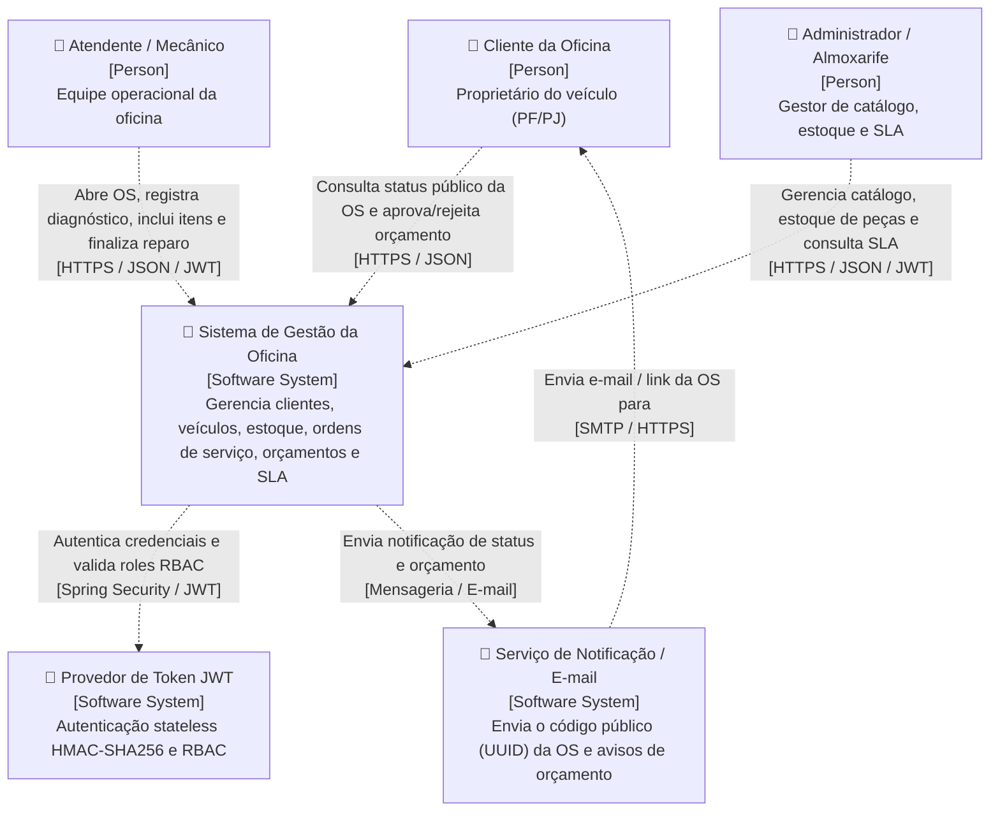
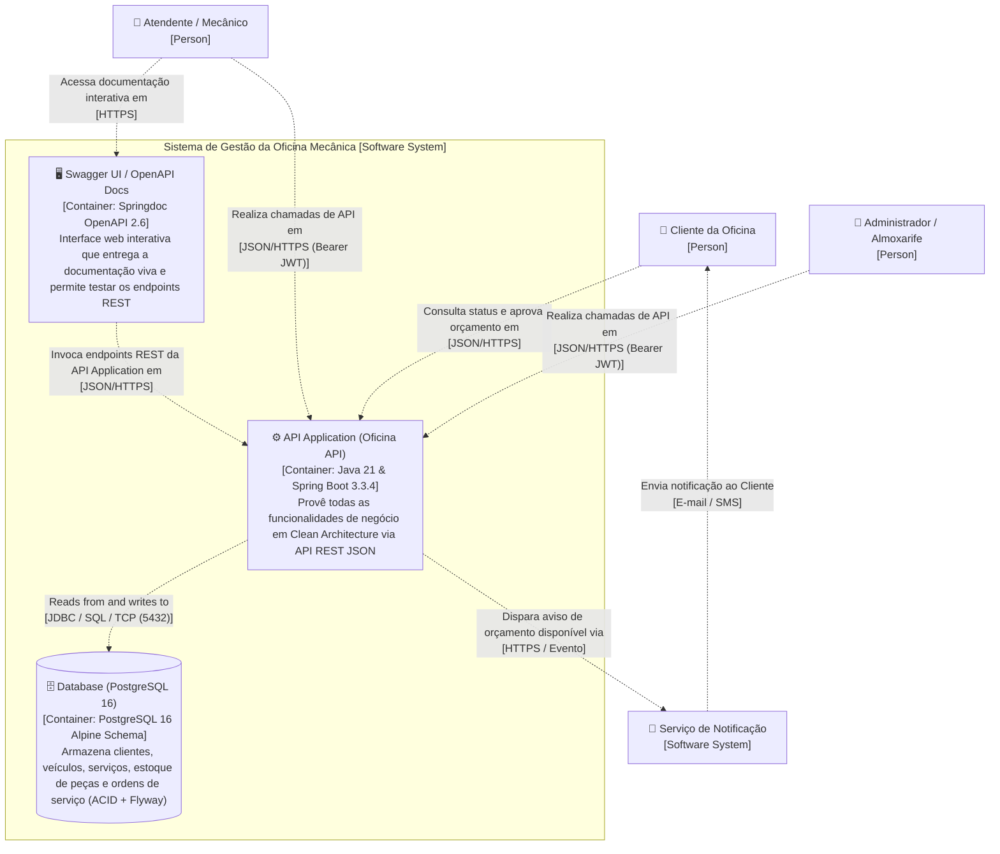
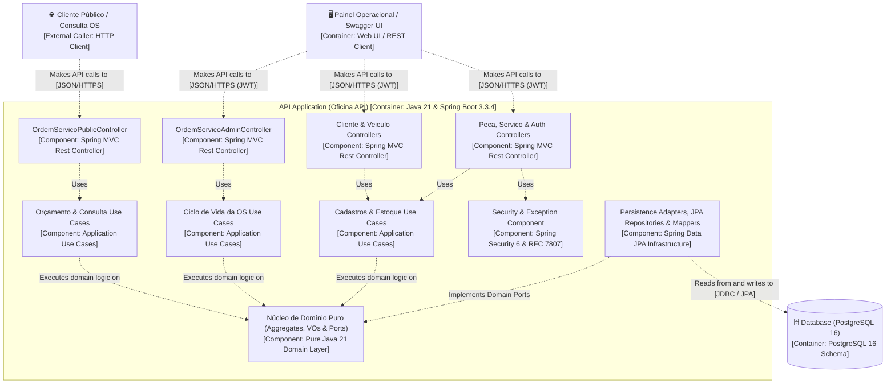

# Documentação de Arquitetura com o Modelo C4 — Oficina Mecânica

O **Modelo C4**, criado por **Simon Brown**, é uma abordagem incremental, hierárquica e padronizada para visualizar e documentar arquiteturas de software em diferentes níveis de abstração (**Contexto**, **Contêiner**, **Componente** e **Código**, além da visão macro de **System Landscape**).

---

## 1. Comparação entre C4 Model, HLD (High-Level Design) e LLD (Low-Level Design)

O Modelo C4 une a visão macro executiva (HLD) e o detalhamento técnico de implementação (LLD) em uma transição fluida e progressiva:

| Aspecto | C4 Model (Adotado no Projeto) | HLD (High-Level Design) | LLD (Low-Level Design) |
| :--- | :--- | :--- | :--- |
| **Visão Geral** | **Sim, com transição gradual** (System Landscape ➔ Contexto ➔ Contêiner) | Sim, mas superficial | Não, foco exclusivo nos detalhes |
| **Nível de Detalhe** | **Progressivo, de alto a baixo** (4 níveis de zoom + Landscape) | Alto nível, menos detalhado | Detalhes específicos de classes e métodos |
| **Público-Alvo** | **Técnicos e não técnicos** (clientes, gestores, arquitetos e devs) | Executivos, gestores e stakeholders | Desenvolvedores(as) e revisores de código |

---

## 2. Visão Organizacional: System Landscape Diagram (`[System Landscape]`)

Na prática, os sistemas nunca funcionam isoladamente: o **System Landscape Diagram** apresenta o mapa de sistemas e pessoas (externas e internas) dentro da fronteira organizacional **`Oficina Mecânica [Enterprise]`**.

### Elementos do System Landscape:
- **Pessoas Externas (`#08427b`):**
  - **`Cliente da Oficina [Person]`:** Proprietário do veículo (Pessoa Física ou Jurídica) que solicita reparos, acompanha o andamento da OS e aprova/rejeita o orçamento.
- **Fronteira Organizacional (`Oficina Mecânica [Enterprise]`):**
  - **Equipe Interna (`#686868`):**
    - **`Atendente / Recepção [Person]`:** Realiza o atendimento inicial, cadastra cliente/veículo, abre a Ordem de Serviço e registra a entrega do veículo finalizado.
    - **`Mecânico Operacional [Person]`:** Executa a avaliação técnica (diagnóstico), adiciona serviços e peças ao orçamento e executa/finaliza os reparos.
    - **`Admin / Almoxarife [Person]`:** Gerencia o catálogo de serviços, o controle de estoque de peças (reposição, baixa e alertas de estoque mínimo) e monitora o SLA (tempo médio de execução).
  - **Sistemas no Escopo Corporativo:**
    - **`Sistema de Gestão da Oficina [Software System]` (`#b81d13`):** Sistema central (Core) responsável pelo ciclo de vida das Ordens de Serviço, orçamentos automáticos, estoque transacional ACID e indicadores operacionais.
    - **`Portal Público de Status da OS [Software System / Public API]` (`#999999`):** Interface pública desacoplada de dados sensíveis (LGPD) para consulta de andamento e aprovação/rejeição de orçamentos pelo cliente.
    - **`Serviço de Notificação / E-mail [Software System]` (`#999999`):** Serviço responsável por comunicar ao cliente o identificador público (`UUID`) da OS e avisos de orçamento disponível.

---

## 3. Nível 1: Diagrama de Contexto de Sistema (`[System Context]`)

O **Diagrama de Contexto** responde às perguntas fundamentais: *"Qual é o propósito do sistema?"* e *"Quem usa ou interage com o sistema?"*. É o nível ideal para alinhar o entendimento entre equipes técnicas e stakeholders de negócio.

### Detalhamento do Nível 1 (Contexto):
- **Propósito Central:** Centralizar e automatizar todo o fluxo operacional de uma oficina mecânica — desde a recepção do veículo até a entrega final — garantindo precisão matemática nos orçamentos e consistência transacional no controle de estoque.
- **Usuários (`[Person]`):**
  - **`Cliente da Oficina`:** Interage exclusivamente com as rotas públicas (`/api/v1/public/ordens-servico/{id}/...`), consultando o status em conformidade com a LGPD e aprovando ou rejeitando o orçamento.
  - **`Atendente / Mecânico`:** Opera os fluxos internos protegidos por JWT (`ROLE_MECANICO`, `ROLE_ADMIN`) para cadastro, abertura de OS, diagnóstico, composição de orçamento, finalização e entrega.
  - **`Administrador / Almoxarife`:** Administra o catálogo de serviços, o estoque de peças (`/repor-estoque`, `/debitar-estoque`, `/abaixo-minimo`) e acompanha o tempo médio de execução (`/api/v1/servicos/tempo-medio`).

---

## 4. Nível 2: Diagrama de Contêineres (`[Container]`)

O **Diagrama de Contêineres** funciona como o elo intermediário entre o HLD e o LLD, mostrando como o **`Sistema de Gestão da Oficina Mecânica [Software System]`** é dividido em unidades executáveis independentes (aplicações, interfaces web e bancos de dados) e como elas se comunicam via rede.

### Responsabilidades dos Contêineres (Nível 2):
1. **`Swagger UI / OpenAPI Docs [Container: Springdoc OpenAPI 2.6]`:**
   - Disponibiliza a interface web interativa (`/swagger-ui.html` e `/v3/api-docs`) com suporte nativo a autenticação `Bearer JWT` para inspeção e execução de contratos REST.
2. **`API Application (Oficina API) [Container: Java 21 & Spring Boot 3.3.4]`:**
   - Contêiner executável empacotado em imagem Docker multi-stage (`eclipse-temurin:21-jre-alpine`), rodando sob usuário não-root (`appuser`).
   - Implementa os casos de uso em **Clean Architecture**, autenticação stateless JWT, tratamento global de erros **RFC 7807 (`ProblemDetail`)** e endpoints de observabilidade (`/actuator/health`).
3. **`Database (PostgreSQL 16) [Container: PostgreSQL 16 Alpine Schema]`:**
   - Banco de dados relacional com garantias **ACID**, pool de conexões **HikariCP**, versionamento automatizado via **Flyway** (`V1__init_schema.sql`, `V2__seed_data.sql`) e constraints físicas de integridade (`CHECK (saldo_estoque >= 0)`).

---

## 5. Nível 3: Diagrama de Componentes (`[Component]`)

O **Diagrama de Componentes** faz um *zoom in* dentro do contêiner **`API Application`**, detalhando como os módulos internos estão organizados em **Clean Architecture** (Apresentação ➔ Aplicação ➔ Domínio Puro ⬅ Infraestrutura) para garantir alta coesão e baixo acoplamento.

### Detalhamento dos Componentes da `API Application` (Nível 3):
- **Controllers REST (`[Component: Spring MVC Rest Controller]`):**
  - [`OrdemServicoPublicController`](../../src/main/java/br/com/fiap/soat/oficina/presentation/controller/OrdemServicoPublicController.java): Consulta pública de status (`/status`), aprovação (`/aprovar`) e rejeição (`/rejeitar`) do orçamento.
  - [`OrdemServicoAdminController`](../../src/main/java/br/com/fiap/soat/oficina/presentation/controller/OrdemServicoAdminController.java): Abertura de OS, início e registro de diagnóstico, adição/remoção de serviços e peças, submissão para aprovação, finalização, entrega e listagem ordenada por prioridade.
  - [`ClienteController`](../../src/main/java/br/com/fiap/soat/oficina/presentation/controller/ClienteController.java) & [`VeiculoController`](../../src/main/java/br/com/fiap/soat/oficina/presentation/controller/VeiculoController.java): Gestão cadastral e buscas por CPF/CNPJ (`/documento/{documento}`) e placa (`/placa/{placa}`).
  - [`PecaController`](../../src/main/java/br/com/fiap/soat/oficina/presentation/controller/PecaController.java), [`ServicoController`](../../src/main/java/br/com/fiap/soat/oficina/presentation/controller/ServicoController.java) & [`AuthController`](../../src/main/java/br/com/fiap/soat/oficina/presentation/controller/AuthController.java): Catálogo de serviços, cálculo de tempo médio (`/tempo-medio`), gestão de estoque (`/repor-estoque`, `/debitar-estoque`, `/abaixo-minimo`) e login JWT (`/auth/login`).
- **Casos de Uso (`[Component: Application Use Cases (Pure Java)]`):**
  - Classes Java puras registradas via [`UseCaseBeanConfig`](../../src/main/java/br/com/fiap/soat/oficina/infrastructure/config/UseCaseBeanConfig.java) e [`CrudUseCaseBeanConfig`](../../src/main/java/br/com/fiap/soat/oficina/infrastructure/config/CrudUseCaseBeanConfig.java), orquestrando fluxos transacionais como [`AprovarOrcamentoUseCase`](../../src/main/java/br/com/fiap/soat/oficina/application/usecase/ordemservico/AprovarOrcamentoUseCase.java).
- **Núcleo de Domínio Puro (`[Component: Pure Java 21 Domain Layer]`):**
  - Agregados ([`OrdemServico`](../../src/main/java/br/com/fiap/soat/oficina/domain/entity/OrdemServico.java), [`Cliente`](../../src/main/java/br/com/fiap/soat/oficina/domain/entity/Cliente.java), [`Veiculo`](../../src/main/java/br/com/fiap/soat/oficina/domain/entity/Veiculo.java), [`Peca`](../../src/main/java/br/com/fiap/soat/oficina/domain/entity/Peca.java), [`Servico`](../../src/main/java/br/com/fiap/soat/oficina/domain/entity/Servico.java)), Value Objects ([`StatusOS`](../../src/main/java/br/com/fiap/soat/oficina/domain/valueobject/StatusOS.java), [`Dinheiro`](../../src/main/java/br/com/fiap/soat/oficina/domain/valueobject/Dinheiro.java), [`CpfCnpj`](../../src/main/java/br/com/fiap/soat/oficina/domain/valueobject/CpfCnpj.java), [`Placa`](../../src/main/java/br/com/fiap/soat/oficina/domain/valueobject/Placa.java)) e Portas de Repositório (`*RepositoryPort`).
- **Infraestrutura e Segurança (`[Component: Infrastructure Layer]`):**
  - Adaptadores JPA (`*RepositoryAdapter`), Mappers bidirecionais (`*Mapper`), [`JwtAuthenticationFilter`](../../src/main/java/br/com/fiap/soat/oficina/infrastructure/security/JwtAuthenticationFilter.java) e [`GlobalExceptionHandler`](../../src/main/java/br/com/fiap/soat/oficina/presentation/exception/GlobalExceptionHandler.java).

---

## 6. Nível 4: Diagrama de Código (`[Code]`)

O **Diagrama de Código** é o nível mais técnico do C4 Model, utilizado para documentar a estrutura interna de classes, interfaces, pacotes e exceções de um componente crítico para auditoria e manutenção.

Abaixo está o Diagrama de Código UML detalhando o componente crítico de **Aprovação de Orçamento e Baixa Transacional de Estoque** (`AprovarOrcamentoUseCase`, portas `OrdemServicoRepositoryPort` / `PecaRepositoryPort`, agregados `OrdemServico` e `Peca`, Value Objects `StatusOS` e `Dinheiro` e hierarquia de exceções `DomainException`):

### Como ler o Diagrama de Código (Nível 4):
1. **Interfaces de Porta (`OrdemServicoRepositoryPort` / `PecaRepositoryPort`):** Representadas pela notação UML *lollipop* no topo, garantindo inversão de dependência (DIP).
2. **Caso de Uso (`AprovarOrcamentoUseCase`):**
   - **`+uses`** sob transação atômica o agregado [`OrdemServico`](../../src/main/java/br/com/fiap/soat/oficina/domain/entity/OrdemServico.java) (`os.aprovar()`) e **`+debits stock`** no agregado [`Peca`](../../src/main/java/br/com/fiap/soat/oficina/domain/entity/Peca.java) (`peca.debitarEstoque(qtd)`).
   - **`+creates`** o record imutável de saída [`OrdemServicoOutput`](../../src/main/java/br/com/fiap/soat/oficina/application/dto/OrdemServicoOutput.java).
   - **`+throws`** as exceções de domínio [`SaldoEstoqueInsuficienteException`](../../src/main/java/br/com/fiap/soat/oficina/domain/exception/SaldoEstoqueInsuficienteException.java) (convertida em HTTP 409 Conflict) ou [`TransicaoStatusInvalidaException`](../../src/main/java/br/com/fiap/soat/oficina/domain/exception/TransicaoStatusInvalidaException.java) (convertida em HTTP 422 Unprocessable Entity), ambas subclasses de [`DomainException`](../../src/main/java/br/com/fiap/soat/oficina/domain/exception/DomainException.java).
