# Diagramas de Domain-Driven Design (DDD) e Arquitetura - Oficina Mecânica

Este documento consolida os diagramas estratégicos, táticos, comportamentais e estruturais de **Domain-Driven Design (DDD)** e **Arquitetura de Software**, mantendo correspondência direta (1:1) com o código-fonte implementado no repositório.

> 🎨 **Quadro Público no Miro e Documentos Exportados:**
> - **Quadro Público no Miro (Visualização Direta):** [https://miro.com/app/board/uXjVETBYsng=/?share_link_id=296220385966](https://miro.com/app/board/uXjVETBYsng=/?share_link_id=296220385966)
> - [diagramas.pdf](diagramas.pdf) — Versão consolidada em PDF dos diagramas estratégicos, táticos e C4.
> - [event-storming.pdf](event-storming.pdf) — Painéis completos de Event Storming em PDF.
> - [linguagem-ubiqua.md](linguagem-ubiqua.md) — Glossário da Linguagem Ubíqua e Rastreabilidade com o Código.

---

## 1. Diagrama Estratégico: Mapa de Contextos Delimitados (Bounded Contexts / Context Map)

Embora a aplicação seja implantada fisicamente como um **Monólito Modular em Clean Architecture**, a modelagem estratégica seguiu a separação lógica em **4 Contextos Delimitados (Bounded Contexts)** com fronteiras bem definidas e referências por identidade (`UUID`):

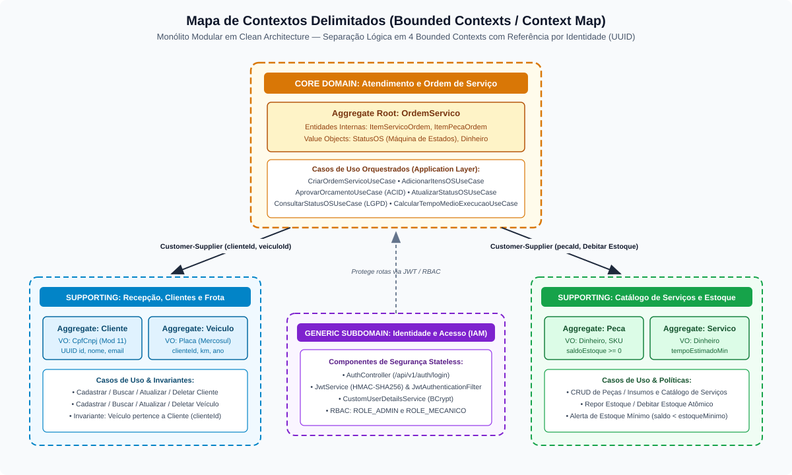

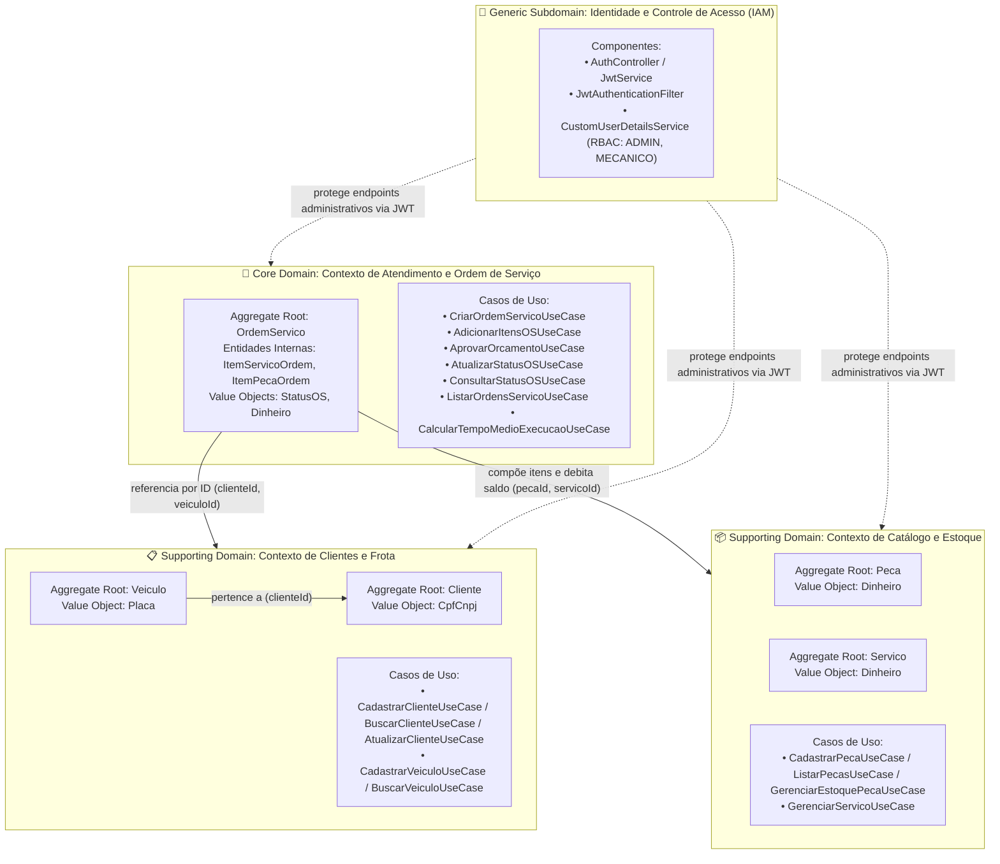

---

## 2. Diagrama Tático de Domínio: Agregados, Entidades e Objetos de Valor (DDD Tactical Design)

O diagrama de classes abaixo reflete exatamente o pacote `br.com.fiap.soat.oficina.domain` implementado em Java 21 puro:

```mermaid
classDiagram
    class OrdemServico {
        <<Aggregate Root>>
        -UUID id
        -UUID clienteId
        -UUID veiculoId
        -StatusOS status
        -String descricaoProblema
        -String diagnostico
        -List~ItemServicoOrdem~ itensServico
        -List~ItemPecaOrdem~ itensPeca
        -LocalDateTime dataAbertura
        -LocalDateTime dataAprovacao
        -LocalDateTime dataFinalizacao
        -LocalDateTime dataEntrega
        +abrir(UUID clienteId, UUID veiculoId, String descricaoProblema)$ OrdemServico
        +iniciarDiagnostico() void
        +registrarDiagnostico(String diagnostico) void
        +adicionarItemServico(ItemServicoOrdem item) void
        +removerItemServico(UUID itemId) void
        +adicionarItemPeca(ItemPecaOrdem item) void
        +removerItemPeca(UUID itemId) void
        +aguardarAprovacao() void
        +aprovar() void
        +rejeitar() void
        +finalizar() void
        +entregar() void
        +cancelar() void
        +calcularValorTotal() Dinheiro
        +calcularTotalServicos() Dinheiro
        +calcularTotalPecas() Dinheiro
        +calcularTempoExecucaoEmMinutos() OptionalLong
    }

    class ItemServicoOrdem {
        <<Internal Entity>>
        -UUID id
        -String descricao
        -Integer quantidade
        -Dinheiro valorUnitario
        +criar(String descricao, Integer qtd, Dinheiro valor)$ ItemServicoOrdem
        +calcularSubtotal() Dinheiro
    }

    class ItemPecaOrdem {
        <<Internal Entity>>
        -UUID id
        -UUID pecaId
        -String nomePeca
        -Integer quantidade
        -Dinheiro valorUnitario
        +criar(UUID pecaId, String nome, Integer qtd, Dinheiro valor)$ ItemPecaOrdem
        +calcularSubtotal() Dinheiro
    }

    class Cliente {
        <<Aggregate Root>>
        -UUID id
        -String nome
        -CpfCnpj cpfCnpj
        -String telefone
        -String email
        +criar(String nome, CpfCnpj doc, String tel, String email)$ Cliente
        +atualizar(String nome, String tel, String email) void
    }

    class Veiculo {
        <<Aggregate Root>>
        -UUID id
        -UUID clienteId
        -Placa placa
        -String marca
        -String modelo
        -Integer anoFabricacao
        -Integer anoModelo
        -String cor
        -Integer quilometragemAtual
        +criar(...)$ Veiculo
        +atualizarCadastro(String marca, String modelo, Integer anoFab, Integer anoMod, String cor) void
        +atualizarQuilometragem(Integer novaKm) void
    }

    class Peca {
        <<Aggregate Root>>
        -UUID id
        -String codigo
        -String nome
        -String descricao
        -Dinheiro precoUnitario
        -Integer saldoEstoque
        -Integer estoqueMinimo
        +criar(...)$ Peca
        +creditarEstoque(int quantidade) void
        +debitarEstoque(int quantidade) void
        +abaixoDoEstoqueMinimo() boolean
        +atualizarPreco(Dinheiro novoPreco) void
        +atualizarDadosCadastrais(String nome, String descricao, Integer estoqueMinimo) void
    }

    class Servico {
        <<Aggregate Root>>
        -UUID id
        -String codigo
        -String nome
        -String descricao
        -Dinheiro precoPadrao
        -Integer tempoEstimadoMinutos
        +criar(...)$ Servico
        +atualizar(String nome, String descricao, Dinheiro preco, Integer tempo) void
    }

    class StatusOS {
        <<Value Object / Enum>>
        RECEBIDA
        EM_DIAGNOSTICO
        AGUARDANDO_APROVACAO
        EM_EXECUCAO
        FINALIZADA
        ENTREGUE
        CANCELADA
        +podeTransicionarPara(StatusOS destino) boolean
    }

    class Dinheiro {
        <<Value Object>>
        +BigDecimal valor
        +somar(Dinheiro outro) Dinheiro
        +multiplicar(int fator) Dinheiro
    }

    class CpfCnpj {
        <<Value Object>>
        +String valor
        +formatado() String
        +isCpf() boolean
        +isCnpj() boolean
    }

    class Placa {
        <<Value Object>>
        +String valor
        +isMercosul() boolean
    }

    OrdemServico *-- "0..*" ItemServicoOrdem : compõe
    OrdemServico *-- "0..*" ItemPecaOrdem : compõe
    OrdemServico *-- "1" StatusOS : estado atual
    OrdemServico ..> Dinheiro : calcula orçamento
    Cliente *-- "1" CpfCnpj : possui
    Veiculo *-- "1" Placa : possui
    Peca *-- "1" Dinheiro : preço unitário
    Servico *-- "1" Dinheiro : preço padrão
```

---

## 3. Diagrama de Máquina de Estados da Ordem de Serviço (`StatusOS`)

A máquina de estados finita implementada no enum [`StatusOS`](../../src/main/java/br/com/fiap/soat/oficina/domain/valueobject/StatusOS.java) e protegida pela raiz de agregação [`OrdemServico`](../../src/main/java/br/com/fiap/soat/oficina/domain/entity/OrdemServico.java) impede transições inválidas ou regressões de status:

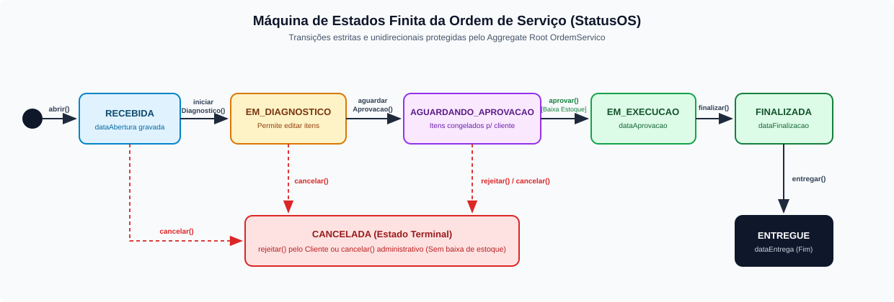

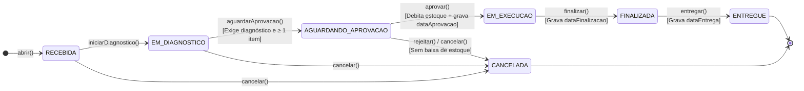

---

## 4. Diagramas de Sequência dos Fluxos Principais

### 4.1 Fluxo de Criação da Ordem de Serviço, Diagnóstico e Geração Automática de Orçamento

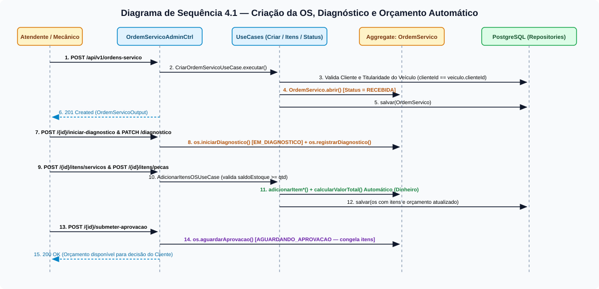

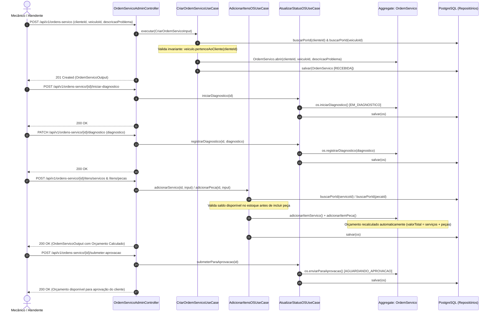

### 4.2 Fluxo de Acompanhamento Público pelo Cliente, Aprovação/Rejeição e Execução até Entrega

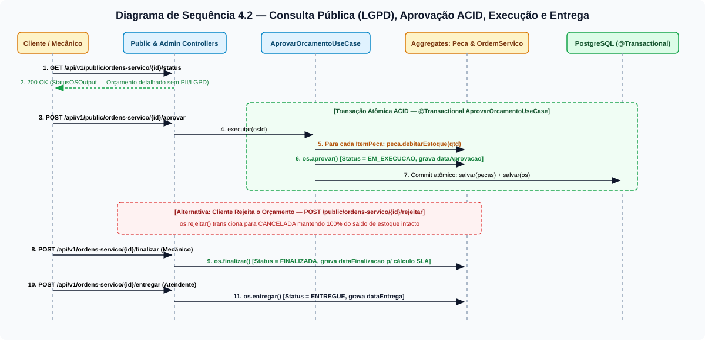

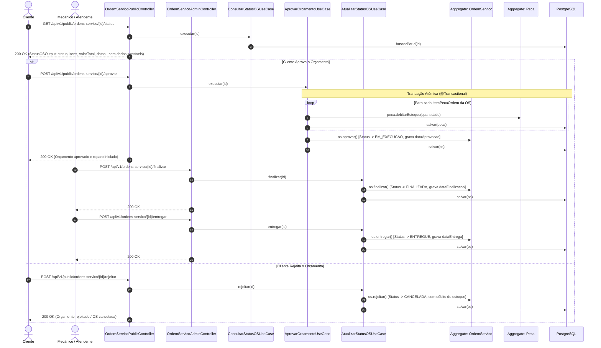

---

## 5. Diagrama Entidade-Relacionamento (DER - PostgreSQL 16 / Flyway `V1__init_schema.sql`)

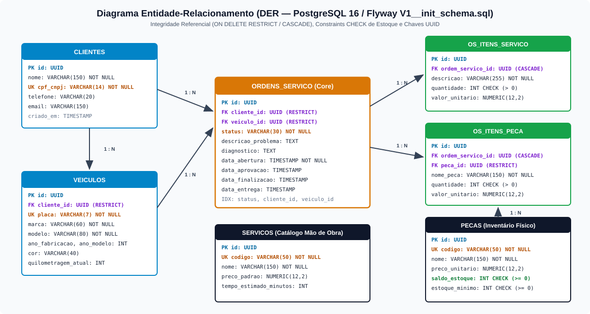

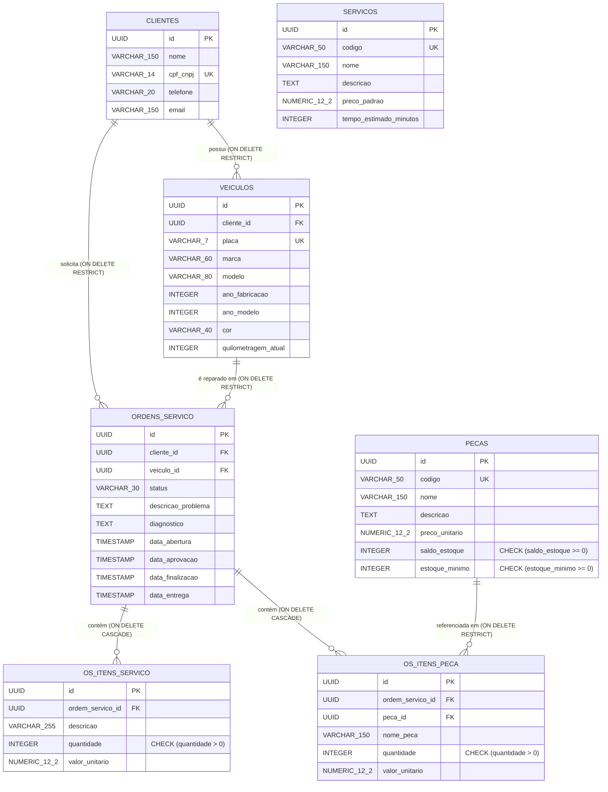

---

## 6. Diagramas de Arquitetura — Modelo C4 Completo

Os diagramas abaixo seguem a notação visual do **Modelo C4 (Structurizr)**, cobrindo o **System Landscape** e os **4 níveis do C4 Model** (**Contexto**, **Contêiner**, **Componente** e **Código**). O detalhamento completo encontra-se em [`docs/architecture/c4-model.md`](../architecture/c4-model.md).

### 6.1 Visão Organizacional: System Landscape (`[System Landscape] Oficina Mecânica`)
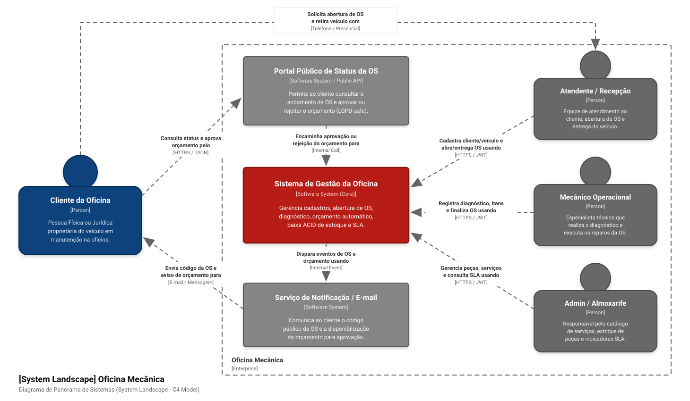

### 6.2 Nível 1: Diagrama de Contexto (`[System Context] Sistema de Gestão de Oficina Mecânica`)
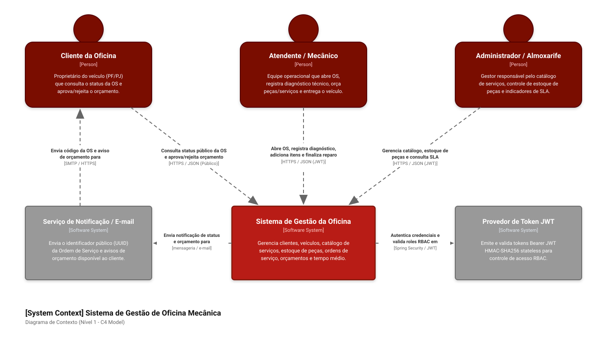

### 6.3 Nível 2: Diagrama de Contêineres (`[Container] Sistema de Gestão de Oficina Mecânica`)
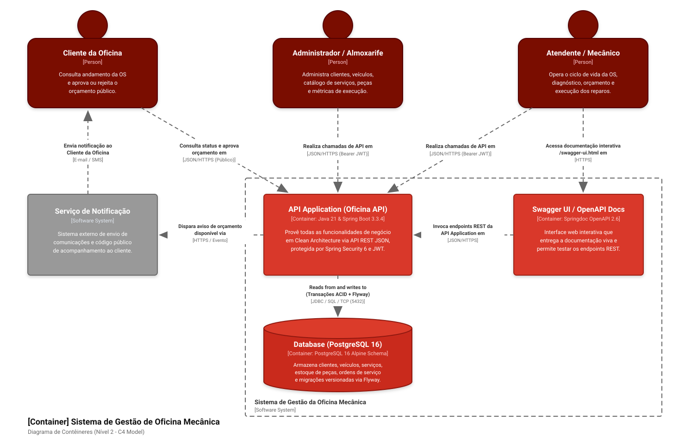

### 6.4 Nível 3: Diagrama de Componentes (`[Component] Sistema de Gestão de Oficina Mecânica - API Application`)
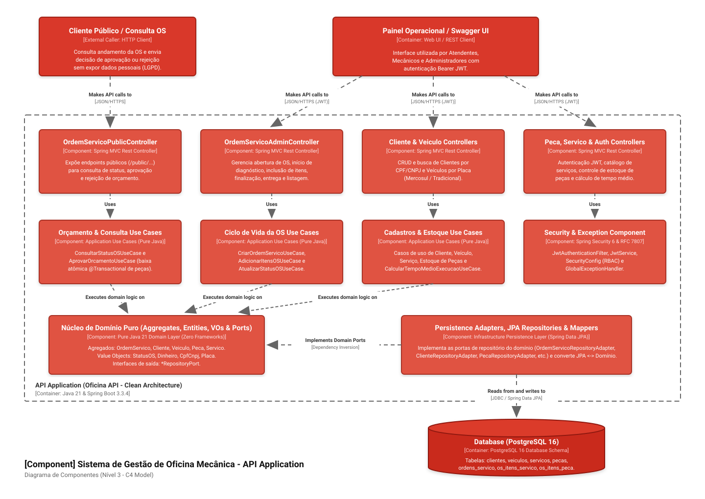

### 6.5 Nível 4: Diagrama de Código (`[Code] Sistema de Gestão de Oficina Mecânica - AprovarOrcamentoUseCase & Agregados`)
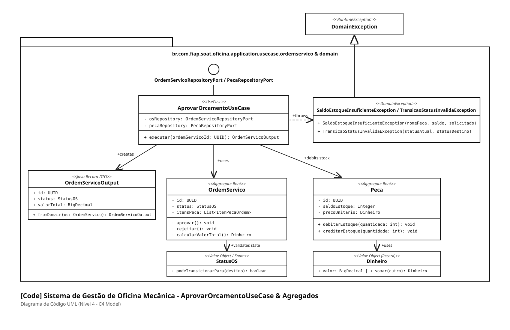

