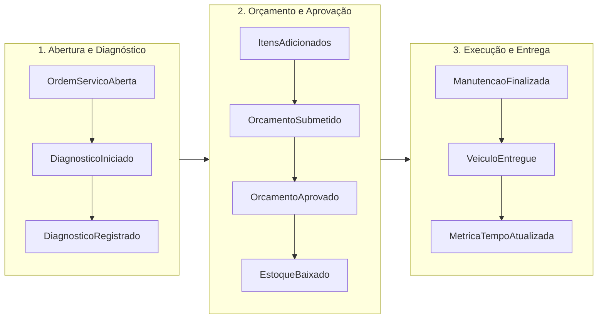

# Event Storming - Domínio da Oficina Mecânica

O **Event Storming** é um workshop colaborativo de modelagem de domínio orientado a eventos (DDD) criado por Alberto Brandolini. Este documento formaliza os fluxos operacionais mapeados para a **Oficina Mecânica** da Fase 1 da pós-graduação SOAT.

---

## 1. Convenção de Cores e Notação Semântica

A taxonomia visual dos elementos identificados segue os padrões internacionais da comunidade DDD:

| Elemento | Cor Simbólica | Semântica | Formato / Sintaxe |
| :--- | :--- | :--- | :--- |
| **Evento de Domínio (Domain Event)** | **Laranja** | Fato relevante ocorrido no passado no negócio. Imutável. | `[Verbo no Particípio/Passado]` *(ex.: OrdemServicoAberta)* |
| **Comando (Command)** | **Azul** | Intenção ou instrução direta executada por um ator ou sistema. | `[Verbo no Imperativo]` *(ex.: AbrirOrdemServico)* |
| **Ator (Actor/User)** | **Amarelo** | Persona humana ou papel que executa um comando. | `[Substantivo/Papel]` *(ex.: Atendente, Mecânico, Cliente)* |
| **Agregado (Aggregate)** | **Bege / Amarelo Claro** | Fronteira transacional e guardião das invariantes de negócio. | `[Substantivo do Aggregate]` *(ex.: OrdemServico, Peca)* |
| **Política / Regra (Policy)** | **Roxo / Lilás** | Reação automática: "Sempre que [Evento], então [Comando]". | `[Quando ... então ...]` |
| **Read Model / Projeção** | **Verde** | Visão otimizada de dados para tomada de decisão ou consulta. | `[Nome da Visão]` *(ex.: VisaoOrcamentoPublico)* |
| **Sistema Externo** | **Rosa** | Sistema externo de mensageria, pagamento ou notificação. | `[Sistema Externo]` |

---

## 2. Fluxos de Negócio Mapeados

---

### Fluxo 1: Abertura e Diagnóstico Técnico

Este fluxo compreende a recepção do veículo na oficina, a validação de titularidade do proprietário e o início dos procedimentos de diagnóstico mecânico.

#### Passos do Fluxo:
1. **Ator:** Atendente / Recepcionista (Amarelo)
2. **Comando:** `CadastrarCliente` (Azul) $\rightarrow$ **Agregado:** `Cliente` (Bege)
3. **Evento:** `ClienteCadastrado` (Laranja)
4. **Comando:** `CadastrarVeiculo` (Azul) $\rightarrow$ **Agregado:** `Veiculo` (Bege)
   - *Invariante:* A placa deve seguir o padrão tradicional ou Mercosul e estar vinculada ao cliente existente.
5. **Evento:** `VeiculoCadastrado` (Laranja)
6. **Comando:** `AbrirOrdemServico` (Azul) $\rightarrow$ **Agregado:** `OrdemServico` (Bege)
   - *Invariante:* O veículo deve pertencer obrigatoriamente ao cliente informado.
7. **Evento:** `OrdemServicoAberta` (Laranja - Status: `RECEBIDA`)
8. **Ator:** Mecânico (Amarelo)
9. **Comando:** `IniciarDiagnostico` (Azul) $\rightarrow$ **Agregado:** `OrdemServico` (Bege)
10. **Evento:** `DiagnosticoIniciado` (Laranja - Status: `EM_DIAGNOSTICO`)
11. **Comando:** `RegistrarLaudoTecnico` (Azul) $\rightarrow$ **Agregado:** `OrdemServico` (Bege)
12. **Evento:** `DiagnosticoTecnicoRegistrado` (Laranja)

---

### Fluxo 2: Orçamento, Aprovação e Controle de Estoque

Neste fluxo, serviços e peças são calculados, o orçamento é submetido à aprovação do cliente por link público e, com o aceite, ocorre a baixa física de inventário.

#### Passos do Fluxo:
1. **Ator:** Mecânico (Amarelo)
2. **Comando:** `AdicionarItemServico` (Azul) $\rightarrow$ **Agregado:** `OrdemServico` (Bege)
3. **Evento:** `ItemServicoAdicionado` (Laranja)
4. **Comando:** `AdicionarItemPeca` (Azul) $\rightarrow$ **Agregado:** `OrdemServico` (Bege)
   - *Política (Roxo):* Verificar se o Agregado `Peca` possui saldo suficiente em estoque no catálogo.
5. **Evento:** `ItemPecaAdicionado` (Laranja)
6. **Comando:** `SubmeterOrcamentoParaAprovacao` (Azul) $\rightarrow$ **Agregado:** `OrdemServico` (Bege)
   - *Invariante:* A OS não pode ser enviada sem laudo de diagnóstico e sem pelo menos 1 serviço ou peça.
   - *Invariante:* Bloqueia qualquer alteração subsequente de itens na OS.
7. **Evento:** `OrcamentoAguardandoAprovacao` (Laranja - Status: `AGUARDANDO_APROVACAO`)
8. **Read Model:** `VisaoStatusPublicoOS` (Verde) consultado pelo Cliente via token público ou código seguro.
9. **Ator:** Cliente (Amarelo)
10. **Comando:** `AprovarOrcamento` (Azul) $\rightarrow$ **Agregado:** `OrdemServico` (Bege)
11. **Evento:** `OrcamentoAprovado` (Laranja - Status: `EM_EXECUCAO`, com registro de `dataAprovacao`)
12. **Política (Roxo):** *Sempre que um Orçamento for aprovado, disparar a baixa física de cada peça alocada.*
13. **Comando Automático:** `DebitarEstoquePeca` (Azul) $\rightarrow$ **Agregado:** `Peca` (Bege)
14. **Evento:** `EstoquePecaDebitado` (Laranja)
15. **Política (Roxo):** *Se saldo de estoque $\le$ estoque mínimo, emitir alerta de reposição para compras.*

---

### Fluxo 3: Finalização, Entrega e Métricas de Eficiência

Este fluxo compreende a conclusão da manutenção técnica, a devolução das chaves ao cliente e a consolidação das métricas de tempo médio de execução da oficina.

#### Passos do Fluxo:
1. **Ator:** Mecânico (Amarelo)
2. **Comando:** `FinalizarExecucaoOS` (Azul) $\rightarrow$ **Agregado:** `OrdemServico` (Bege)
   - *Regra:* Registra o timestamp exato de `dataFinalizacao`.
3. **Evento:** `OrdemServicoFinalizada` (Laranja - Status: `FINALIZADA`)
4. **Ator:** Atendente (Amarelo)
5. **Comando:** `RegistrarEntregaVeiculo` (Azul) $\rightarrow$ **Agregado:** `OrdemServico` (Bege)
   - *Regra:* Registra o timestamp exato de `dataEntrega`.
6. **Evento:** `VeiculoEntregueAoCliente` (Laranja - Status: `ENTREGUE`)
7. **Política (Roxo):** *Sempre que uma OS for finalizada, recalcular o tempo médio de atendimento da oficina.*
8. **Read Model:** `RelatorioTempoMedioExecucao` (Verde)
   - Consolida a duração $\Delta t = (\text{dataFinalizacao} - \text{dataAbertura})$ de todas as ordens finalizadas.

---

## 3. Matriz de Agregados e Invariantes Críticas

| Agregado | Raiz de Agregação | Entidades / VOs Contidos | Invariantes Centrais |
| :--- | :--- | :--- | :--- |
| **Ordem de Serviço** | `OrdemServico` | `ItemServicoOrdem`, `ItemPecaOrdem`, `StatusOS`, `Dinheiro` | - Transições de estado devem seguir a máquina de estados. - Veículo deve pertencer ao cliente. - Itens bloqueados após diagnóstico. - Exige diagnóstico e itens para aprovação. |
| **Cliente** | `Cliente` | `CpfCnpj` | - Documento (CPF ou CNPJ) com dígito verificador matematicamente válido. - E-mail único e telefone obrigatório. |
| **Veículo** | `Veiculo` | `Placa` | - Placa única válida (formato clássico ou Mercosul). - Ano do modelo $\ge$ ano de fabricação $> 1900$. - Quilometragem não regressiva. |
| **Peça / Inventário**| `Peca` | `Dinheiro` | - Saldo de estoque nunca negativo ($saldo \ge 0$). - Débito recusado se quantidade solicitada $>$ saldo atual. |

