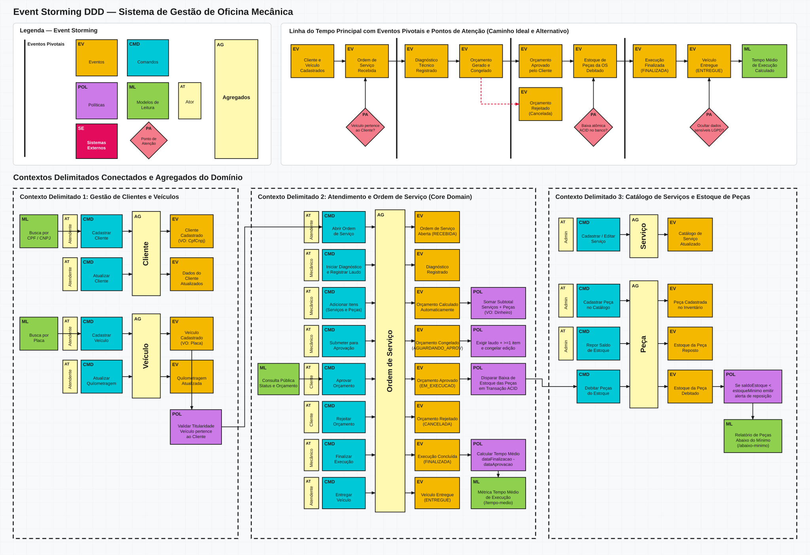
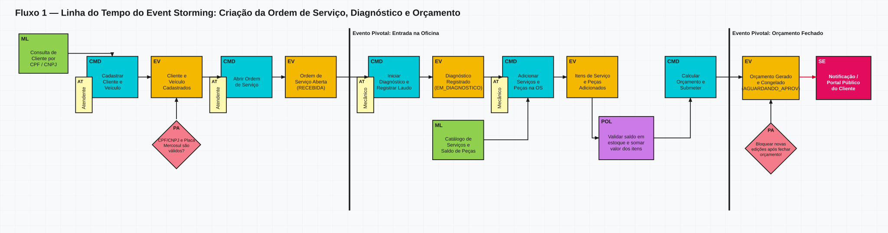
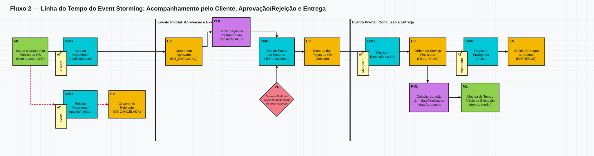
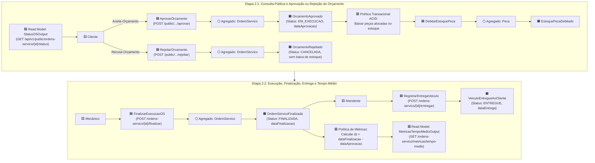
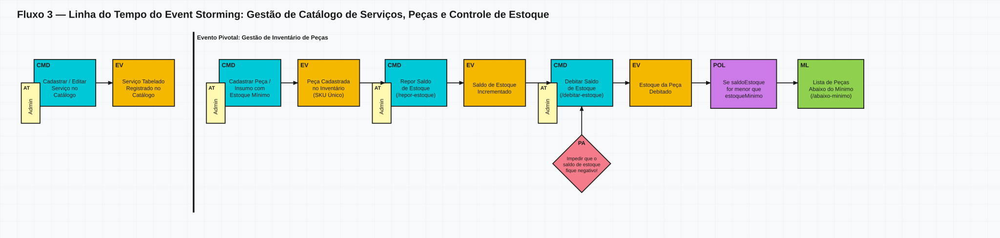
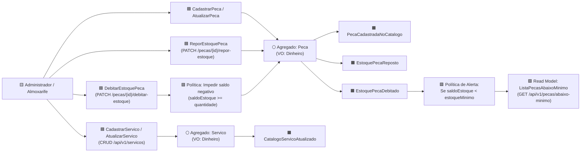
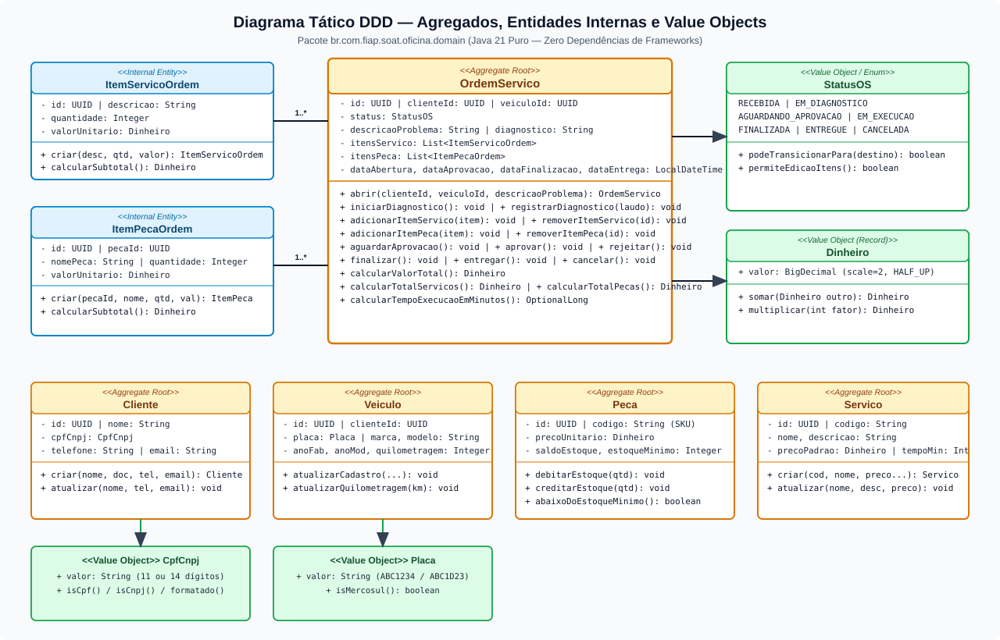
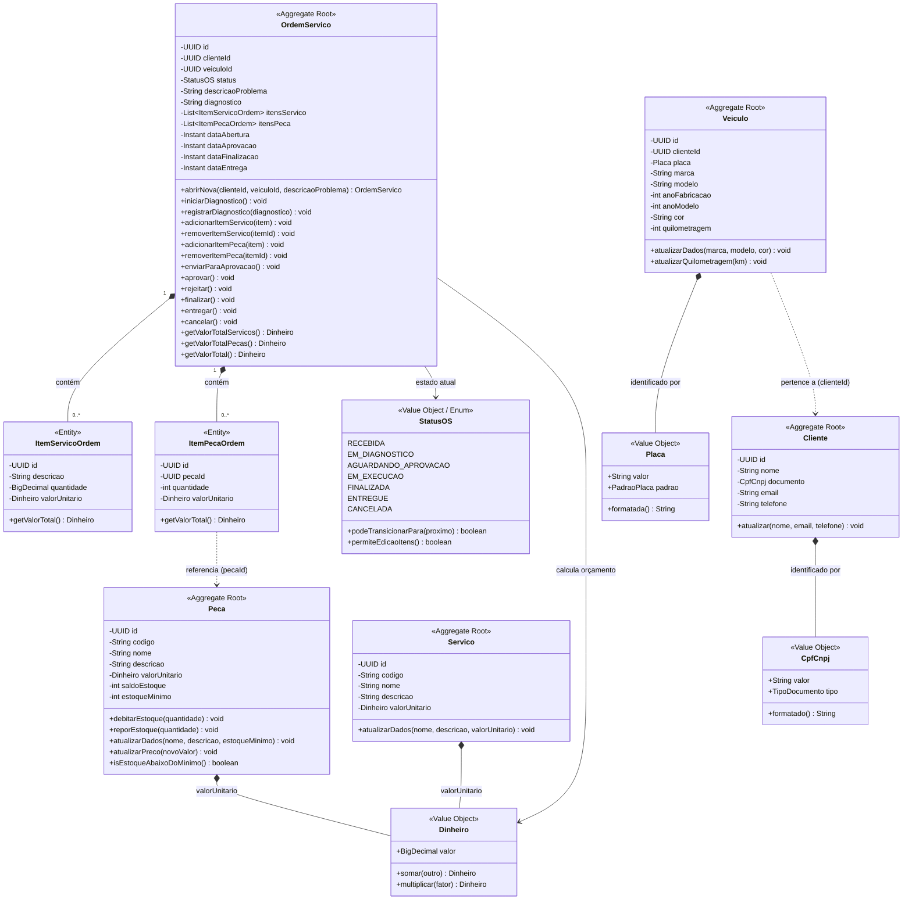

# Event Storming e Diagramas Táticos DDD - Domínio da Oficina Mecânica

O **Event Storming** é um método de modelagem colaborativa de domínio orientado a eventos (DDD), criado por Alberto Brandolini. Este documento apresenta o mapeamento dos fluxos de negócio da **Oficina Mecânica**, detalhando **Eventos de Domínio, Comandos, Atores, Políticas/Regras de Negócio, Agregados, Entidades, Objetos de Valor, Bounded Contexts e Diagramas de Classes Táticos**.

> 📌 **Arquivos Exportados e Quadro Público no Miro:**
> - **Quadro Público no Miro (Visualização Direta):** [https://miro.com/app/board/uXjVETBYsng=/?share_link_id=296220385966](https://miro.com/app/board/uXjVETBYsng=/?share_link_id=296220385966)
> - [event-storming.pdf](event-storming.pdf) — Versão consolidada em PDF dos painéis de Event Storming.
> - [diagramas.pdf](diagramas.pdf) — Versão consolidada em PDF dos diagramas de Bounded Contexts, Agregados, Máquina de Estados e Arquitetura C4.
> - [linguagem-ubiqua.md](linguagem-ubiqua.md) — Glossário da Linguagem Ubíqua, Termos Ambíguos/Sinônimos e Rastreabilidade com o Código.
> - [miro/miro-board-event-storming-completo.svg](miro/miro-board-event-storming-completo.svg) — Board visual completo em SVG vetorial.

---

## Painel Visual Consolidado (Board Event Storming — 3 Fluxos)

---

## 1. Convenção de Cores e Notação Semântica do Event Storming

A notação e a disposição visual dos elementos no Event Storming seguem a seguinte convenção:

| Sigla | Elemento | Formato e Cor | Semântica no Domínio e Posicionamento | Sintaxe / Exemplo |
| :---: | :--- | :--- | :--- | :--- |
| **`EV`** | **Eventos** | 🟧 Quadrado Amarelo-Ouro (`#f5b800`) | Fato relevante que **já aconteceu** no domínio. Posicionado em ordem cronológica da esquerda para a direita. | Verbo no particípio (`Ordem de Serviço Aberta`, `Orçamento Aprovado`, `Estoque Debitado`) |
| **`CMD`** | **Comandos** | 🟦 Quadrado Azul-Ciano (`#00c8d7`) | Ação ou intenção realizada por um ator ou sistema que origina um evento. Posicionado **imediatamente antes** do `EV`. | Verbo no imperativo (`Abrir Ordem de Serviço`, `Aprovar Orçamento`, `Debitar Estoque`) |
| **`POL`** | **Políticas** | 🟪 Quadrado Lilás/Roxo (`#cc7ae8`) | Regra de negócio, restrição ou automação reativa disparada após um `EV` para acionar um novo `CMD`. | Regra condicional (`Política de Baixa Atômica`, `Política de Alerta de Estoque`) |
| **`ML`** | **Modelos de Leitura** | 🟩 Quadrado Verde (`#8fd14f`) | Visão/consulta de dados necessária para que o Ator tome a decisão de executar um `CMD`. Posicionado **antes** do `CMD`. | Substantivo (`Status Público da OS`, `Catálogo de Serviços e Peças`) |
| **`AT`** | **Ator** | 🟨 Retângulo Vertical Amarelo Claro (`#fff9b1`) | Papel/persona que aciona o comando. Posicionado **sobreposto ao canto inferior esquerdo** do `CMD`. | Substantivo (`Atendente`, `Mecânico`, `Cliente`, `Almoxarife`, `Admin`) |
| **`AG`** | **Agregados** | 🌕 Barra Vertical Alta Amarelo Claro (`#fff9b1`) | Conjunto de entidades/VOs tratados como unidade transacional. Posicionado **verticalmente entre a coluna de `CMD` (à esquerda) e a coluna de `EV` (à direita)**. | Substantivo (`Cliente`, `Veículo`, `Ordem de Serviço`, `Serviço`, `Peça`) |
| **`SE`** | **Sistemas Externos** | 🟥 Quadrado Rosa/Magenta Escuro (`#e30b5c`) | Sistema ou serviço fora do domínio principal acionado por eventos ou comandos. | Substantivo (`Notificação ao Cliente`, `Provedor de Autenticação JWT`) |
| **`PA`** | **Ponto de Atenção** | 🔶 Losango Rosa-Salmão (`#f47b89`) | Dúvida de negócio, gargalo, concorrência ou regra crítica que exige atenção especial na etapa. | Alerta/Risco (`Concorrência de estoque na aprovação`, `CPF/CNPJ ou Placa inválidos`) |
| **`—`** | **Eventos Pivotais** | ⬛ Linha Vertical Preta Espessa | Marco divisor na linha do tempo que indica **mudança de fase** significativa no negócio. | Fase (`OS Aberta`, `Orçamento Disponibilizado`, `Aprovação`, `Finalização`, `Entrega`) |
| **`[ ]`** | **Contextos Delimitados** | ⬜ Retângulo Grande Tracejado | Fronteira semântica que agrupa Agregados (`AG`), Comandos (`CMD`), Eventos (`EV`), Políticas (`POL`) e Modelos de Leitura (`ML`) fortemente conectados. | `Recepção e Cadastro`, `Ordem de Serviço (Core)`, `Catálogo e Estoque` |

---

## 2. Event Storming — Fluxo 1: Criação da Ordem de Serviço

Este fluxo abrange desde a identificação do cliente (por CPF/CNPJ) e cadastro do veículo (placa tradicional ou Mercosul) até a abertura da Ordem de Serviço, diagnóstico técnico, inclusão de serviços/peças, geração automática do orçamento e disponibilização para aprovação do cliente.

```mermaid
flowchart TB
    subgraph F1_Recepcao["Etapa 1.1: Identificação de Cliente, Veículo e Abertura da OS"]
        direction LR
        A1["🟨 Atendente"] --> C1["🟦 CadastrarCliente / BuscarPorCpfCnpj"]
        C1 --> AGG1["🌕 Agregado: Cliente<br/>(VO: CpfCnpj)"]
        AGG1 --> EV1["🟧 ClienteIdentificado"]
        EV1 --> C2["🟦 CadastrarVeiculo"]
        C2 --> AGG2["🌕 Agregado: Veiculo<br/>(VO: Placa)"]
        AGG2 --> EV2["🟧 VeiculoCadastrado"]
        EV2 --> C3["🟦 AbrirOrdemServico"]
        C3 --> P1["🟪 Política: Validar se Veículo pertence ao Cliente"]
        P1 --> AGG3["🌕 Agregado: OrdemServico"]
        AGG3 --> EV3["🟧 OrdemServicoAberta<br/>(Status: RECEBIDA)"]
    end

    subgraph F1_Diagnostico["Etapa 1.2: Diagnóstico, Inclusão de Serviços/Peças e Geração do Orçamento"]
        direction LR
        A2["🟨 Mecânico"] --> C4["🟦 IniciarDiagnostico"]
        C4 --> AGG4["🌕 Agregado: OrdemServico"]
        AGG4 --> EV4["🟧 DiagnosticoIniciado<br/>(Status: EM_DIAGNOSTICO)"]
        EV4 --> C5["🟦 RegistrarLaudoDiagnostico"]
        C5 --> EV5["🟧 DiagnosticoRegistrado"]
        EV5 --> C6["🟦 AdicionarItemServico / AdicionarItemPeca"]
        C6 --> P2["🟪 Política: Validar saldo em estoque da Peça e recalcular Orçamento"]
        P2 --> EV6["🟧 OrcamentoCalculadoAutomaticamente"]
        EV6 --> C7["🟦 SubmeterOrcamentoParaAprovacao"]
        C7 --> P3["🟪 Política: Exigir laudo + ≥1 item e congelar edição"]
        P3 --> EV7["🟧 OrcamentoDisponibilizadoParaAprovacao<br/>(Status: AGUARDANDO_APROVACAO)"]
    end

    F1_Recepcao --> F1_Diagnostico
```

### Detalhamento dos Elementos do Fluxo 1 (Criação da OS):
1. **Ator `Atendente`** executa **`CadastrarCliente`** (`POST /api/v1/clientes`) ou **`BuscarClientePorDocumento`** (`GET /api/v1/clientes/documento/{cpfCnpj}`) no Agregado **`Cliente`** ➔ valida matematicamente o VO **`CpfCnpj`** ➔ gera o evento **`ClienteCadastrado`**.
2. **Ator `Atendente`** executa **`CadastrarVeiculo`** (`POST /api/v1/veiculos`) no Agregado **`Veiculo`** ➔ valida o VO **`Placa`** (Mercosul/Tradicional), ano e quilometragem ➔ gera **`VeiculoCadastrado`**.
3. **Ator `Atendente`** executa **`AbrirOrdemServico`** (`POST /api/v1/ordens-servico`) ➔ **Política de Titularidade:** verifica se `veiculo.clienteId == cliente.id` ➔ inicializa o Agregado **`OrdemServico`** com `dataAbertura` e status **`RECEBIDA`** ➔ gera **`OrdemServicoAberta`**.
4. **Ator `Mecânico`** executa **`IniciarDiagnostico`** (`POST /api/v1/ordens-servico/{id}/iniciar-diagnostico`) e **`RegistrarDiagnostico`** (`PATCH /api/v1/ordens-servico/{id}/diagnostico`) ➔ status avança para **`EM_DIAGNOSTICO`** ➔ gera **`DiagnosticoTecnicoRegistrado`**.
5. **Ator `Mecânico`** executa **`AdicionarItemServico`** (`POST /{id}/itens/servicos`, informando `servicoId` do catálogo ou descrição avulsa) e **`AdicionarItemPeca`** (`POST /{id}/itens/pecas`) ➔ **Política de Estoque e Orçamento:** verifica disponibilidade no Agregado **`Peca`** (`saldoEstoque >= quantidade`) e recalcula dinamicamente `valorTotalServicos`, `valorTotalPecas` e `valorTotal` (`Dinheiro`) ➔ gera **`OrcamentoCalculadoAutomaticamente`**.
6. **Ator `Mecânico`** executa **`SubmeterParaAprovacao`** (`POST /{id}/submeter-aprovacao`) ➔ **Política de Fechamento de Diagnóstico:** exige diagnóstico preenchido e pelo menos 1 item orçado, bloqueia edições futuras (`permiteEdicaoItens() == false`) e transiciona para **`AGUARDANDO_APROVACAO`** ➔ gera **`OrcamentoDisponibilizadoParaAprovacao`**.

---

## 3. Event Storming — Fluxo 2: Acompanhamento da Ordem de Serviço

Este fluxo contempla a consulta pública de andamento pelo cliente, a decisão de aprovação ou rejeição do orçamento, a baixa transacional de estoque, a execução dos reparos, a finalização técnica, a entrega do veículo e o monitoramento do tempo médio de execução.

### Detalhamento dos Elementos do Fluxo 2 (Acompanhamento da OS):
1. **Ator `Cliente`** consulta o Read Model **`StatusOSOutput`** (`GET /api/v1/public/ordens-servico/{id}/status`), visualizando o status atual, o diagnóstico, os itens detalhados do orçamento e o valor total.
2. **Caminho A — Aprovação do Orçamento:**
   - **Ator `Cliente`** executa **`AprovarOrcamento`** (`POST /api/v1/public/ordens-servico/{id}/aprovar`).
   - **Política Transacional ACID (`AprovarOrcamentoUseCase`):** Em uma única transação de banco de dados, debita a quantidade de cada peça no Agregado **`Peca`** (`peca.debitarEstoque()`) e transiciona a **`OrdemServico`** de `AGUARDANDO_APROVACAO` para **`EM_EXECUCAO`**, registrando `dataAprovacao`.
   - Gera os eventos **`OrcamentoAprovado`** e **`EstoquePecaDebitado`**.
3. **Caminho B — Rejeição do Orçamento:**
   - **Ator `Cliente`** executa **`RejeitarOrcamento`** (`POST /api/v1/public/ordens-servico/{id}/rejeitar`).
   - O Agregado **`OrdemServico`** valida que o status é `AGUARDANDO_APROVACAO` e transiciona para **`CANCELADA`** (`os.rejeitar()`), mantendo o estoque intacto ➔ gera **`OrcamentoRejeitado`**.
4. **Finalização e Entrega:**
   - **Ator `Mecânico`** conclui os reparos e executa **`FinalizarExecucao`** (`POST /api/v1/ordens-servico/{id}/finalizar`) ➔ status muda para **`FINALIZADA`** com registro de `dataFinalizacao` ➔ gera **`OrdemServicoFinalizada`**.
   - **Ator `Atendente`** devolve o veículo e executa **`RegistrarEntrega`** (`POST /api/v1/ordens-servico/{id}/entregar`) ➔ status muda para **`ENTREGUE`** com registro de `dataEntrega` ➔ gera **`VeiculoEntregue`**.
5. **Monitoramento do Tempo Médio:**
   - **Ator `Administrador`** consulta **`CalcularTempoMedioExecucao`** (`GET /api/v1/ordens-servico/metricas/tempo-medio`), que consolida a duração média $\Delta t = \text{dataFinalizacao} - \text{dataAprovacao}$ de todas as ordens concluídas.

---

## 4. Event Storming — Fluxo 3: Gestão de Peças, Insumos e Catálogo de Serviços

Este fluxo mapeia a gestão administrativa do catálogo de peças/insumos e serviços, entradas/reposições de mercadoria, baixas avulsas e monitoramento preventivo de estoque mínimo.

### Detalhamento dos Elementos do Fluxo 3 (Gestão de Peças, Insumos e Serviços):
1. **Gestão de Catálogo de Peças e Insumos (`/api/v1/pecas`):**
   - Comandos **`CadastrarPeca`**, **`AtualizarPeca`**, **`BuscarPecaPorId`**, **`ListarPecas`** e **`DeletarPeca`** operam sobre o Agregado **`Peca`**, garantindo unicidade do código SKU (`uk_pecas_codigo`) e valores monetários não negativos (`Dinheiro`).
2. **Controle Físico de Estoque (`/repor-estoque` e `/debitar-estoque`):**
   - O comando **`ReporEstoquePeca`** incrementa o saldo físico na chegada de novos lotes de fornecedores ➔ gera **`EstoquePecaReposto`**.
   - O comando **`DebitarEstoquePeca`** aplica a invariante `saldoEstoque >= quantidade` (lançando `SaldoEstoqueInsuficienteException` / HTTP 409 caso violada) ➔ gera **`EstoquePecaDebitado`**.
3. **Política de Alerta de Reposição (`/api/v1/pecas/abaixo-minimo`):**
   - Sempre que `saldoEstoque < estoqueMinimo`, a propriedade de domínio `peca.isEstoqueAbaixoDoMinimo()` passa a `true` e a peça é listada na projeção de compras/reposição.
4. **Gestão do Catálogo de Serviços (`/api/v1/servicos`):**
   - Comandos **`CadastrarServico`**, **`AtualizarServico`**, **`BuscarServico`** e **`DeletarServico`** mantêm a tabela padronizada de mão de obra da oficina no Agregado **`Servico`**.

---

## 5. Diagrama Tático DDD: Agregados, Entidades e Objetos de Valor

O diagrama de classes abaixo representa a estrutura tática da camada `domain` implementada no projeto:

---

## 6. Matriz Consolidada de Agregados, Regras de Negócio e Comandos

| Agregado | Raiz de Agregação | Entidades e VOs Internos | Comandos Suportados | Políticas e Invariantes Garantidas |
| :--- | :--- | :--- | :--- | :--- |
| **Ordem de Serviço** | `OrdemServico` | `ItemServicoOrdem`, `ItemPecaOrdem`, `StatusOS`, `Dinheiro` | `AbrirOrdemServico`, `IniciarDiagnostico`, `RegistrarDiagnostico`, `AdicionarItemServico`, `RemoverItemServico`, `AdicionarItemPeca`, `RemoverItemPeca`, `SubmeterParaAprovacao`, `AprovarOrcamento`, `RejeitarOrcamento`, `FinalizarExecucao`, `RegistrarEntrega`, `CancelarOS` | - Máquina de estados estrita. - Veículo deve pertencer ao cliente. - Edição de itens bloqueada após diagnóstico. - Submissão exige diagnóstico e $\ge 1$ item. - Aprovação debita estoque em transação ACID. |
| **Cliente** | `Cliente` | `CpfCnpj` | `CadastrarCliente`, `AtualizarCliente`, `BuscarCliente`, `DeletarCliente` | - CPF (11 dígitos) ou CNPJ (14 dígitos) com dígito verificador válido. - Documento e e-mail únicos no sistema. |
| **Veículo** | `Veiculo` | `Placa` | `CadastrarVeiculo`, `AtualizarVeiculo`, `BuscarVeiculo`, `DeletarVeiculo` | - Placa única válida (Tradicional ou Mercosul). - `anoModelo >= anoFabricacao > 1900`. - Quilometragem nunca regride (`novaKm >= kmAtual`). |
| **Peça / Insumo**| `Peca` | `Dinheiro` | `CadastrarPeca`, `AtualizarPeca`, `ReporEstoque`, `DebitarEstoque`, `DeletarPeca` | - Código SKU único. - Saldo de estoque nunca negativo (`saldo >= 0`). - Alerta automático quando `saldo < estoqueMinimo`. |
| **Serviço** | `Servico` | `Dinheiro` | `CadastrarServico`, `AtualizarServico`, `BuscarServico`, `DeletarServico` | - Código de serviço único no catálogo. - Valor unitário de mão de obra nunca negativo. |
