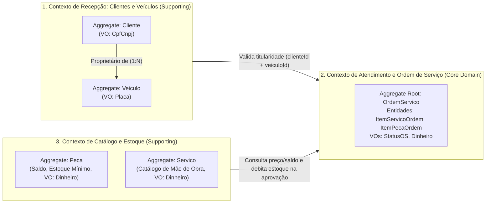

# Linguagem Ubíqua e Modelagem de Domínio (DDD) — Oficina Mecânica

Este documento reúne o vocabulário do domínio da **Oficina Mecânica**, o tratamento de termos ambíguos e sinônimos, os **Contextos Delimitados (Bounded Contexts)** e a relação direta entre os termos de negócio e o código implementado.

> 🎨 **Quadro no Miro (Event Storming & DDD):** [https://miro.com/app/board/uXjVETBYsng=/?share_link_id=296220385966](https://miro.com/app/board/uXjVETBYsng=/?share_link_id=296220385966)

---

## 1. O Desafio do Negócio (Cenário Atual vs. Modelo Desejado)

No dia a dia de uma oficina mecânica, o atendimento envolve diferentes áreas — recepção, mecânicos de bancada e almoxarifado de peças — que muitas vezes trabalham de forma desconectada. Na prática (realidade operacional antes do sistema), os problemas mais comuns são:
* **Divergência entre orçamento e estoque:** O mecânico inclui uma peça no orçamento sem saber se há saldo disponível na prateleira, gerando atraso quando o cliente aprova o reparo.
* **Alterações sem controle:** Itens ou valores são modificados depois que o orçamento já foi passado ao cliente, gerando desgaste e perda de confiança.
* **Falta de visibilidade para o cliente:** O proprietário do veículo precisa ligar na oficina para descobrir se o carro ainda está em diagnóstico, aguardando peça ou pronto para retirada.
* **Distorção no tempo de atendimento:** Não se separa o tempo em que a oficina ficou parada aguardando o "de acordo" do cliente do tempo real em que o mecânico trabalhou no veículo.

O objetivo da modelagem de domínio foi estruturar esses processos a partir de uma **Linguagem Ubíqua** clara, garantindo que as regras do negócio estejam refletidas diretamente nas classes do sistema.

### Como os Conceitos Mudam de Acordo com a Área da Oficina
Um mesmo elemento do negócio é visto de maneiras diferentes dependendo do setor da oficina:
* **Na Recepção / Atendimento:** O foco está na identificação do **Cliente** (`CPF/CNPJ`), no cadastro do **Veículo** (`Placa`), no relato do problema inicial e no acompanhamento da aprovação ou rejeição do **Orçamento**.
* **Na Oficina / Operação Técnica:** O foco está na inspeção mecânica (**Diagnóstico**), na definição dos **Itens de Serviço** e **Itens de Peça** necessários para o conserto, na execução do reparo e no **Tempo de Execução**.
* **No Almoxarifado / Estoque:** O foco está no catálogo de **Peças e Insumos** (código SKU, **Saldo de Estoque**, **Estoque Mínimo**, entradas e baixas) e na tabela padronizada do **Catálogo de Serviços**.

---

## 2. Dicionário da Linguagem Ubíqua (Glossário do Domínio)

### 2.1 Ordem de Serviço (OS)
* **Definição:** Raiz de agregação (*Aggregate Root*) que representa o atendimento de um veículo na oficina, desde o recebimento até a devolução ao cliente.
* **Ciclo de Vida (`StatusOS`):**
  `RECEBIDA` ➔ `EM_DIAGNOSTICO` ➔ `AGUARDANDO_APROVACAO` ➔ `EM_EXECUCAO` ➔ `FINALIZADA` ➔ `ENTREGUE` (podendo ir para `CANCELADA` em caso de desistência ou rejeição do orçamento).
* **Regras principais:**
  - O veículo informado na abertura precisa pertencer ao cliente vinculado à OS.
  - O valor total é sempre a soma dos itens de serviço e dos itens de peça registrados.
  - A inclusão ou remoção de itens só é permitida enquanto a OS está em `RECEBIDA` ou `EM_DIAGNOSTICO`.

### 2.2 Orçamento
* **Definição:** Proposta técnica e financeira gerada automaticamente a partir dos serviços e peças adicionados à Ordem de Serviço durante o diagnóstico.
* **Regras associadas:**
  - Para ser enviado ao cliente (`AGUARDANDO_APROVACAO`), exige que o laudo de diagnóstico esteja preenchido e que haja pelo menos um item (serviço ou peça).
  - Ao entrar em `AGUARDANDO_APROVACAO`, o orçamento fica bloqueado para edições.
  - Pode ser consultado pelo cliente em rota pública (`/api/v1/public/ordens-servico/{id}/status`), sem exibir dados pessoais sensíveis (CPF/CNPJ, telefone ou e-mail).
  - Se **aprovado** (`/aprovar`), debita as peças do estoque na mesma transação e inicia o reparo (`EM_EXECUCAO`). Se **rejeitado** (`/rejeitar`), a OS vai para `CANCELADA` sem movimentar o estoque.

### 2.3 Serviço (Catálogo de Serviços)
* **Definição:** Mão de obra tabelada oferecida pela oficina e mantida no catálogo administrativo (ex.: *Alinhamento e Balanceamento*, *Troca de Óleo e Filtro*, *Revisão de Freios*).
* **Propriedades:** Identificador (`UUID`), código único de catálogo, nome, descrição e valor unitário (`Dinheiro`).

### 2.4 Item de Serviço da OS
* **Definição:** Aplicação de uma mão de obra (vinda do catálogo de serviços ou descrita especificamente no diagnóstico) dentro de uma Ordem de Serviço.
* **Propriedades:** Descrição, quantidade e valor unitário praticado, calculando o subtotal (`quantidade * valorUnitario`).

### 2.5 Peça / Insumo (Catálogo e Estoque)
* **Definição:** Componente físico de reposição ou insumo automotivo mantido no estoque da oficina (ex.: *Filtro de Óleo*, *Fluido de Freio DOT4*, *Pastilha de Freio*).
* **Saldo de Estoque:** Quantidade disponível na prateleira. Não permite valores negativos (`saldoEstoque >= 0`).
* **Estoque Mínimo:** Quantidade mínima de segurança. Quando `saldoEstoque < estoqueMinimo`, a peça aparece na listagem de alerta para reposição (`/api/v1/pecas/abaixo-minimo`).

### 2.6 Item de Peça da OS
* **Definição:** Vínculo de uma peça do estoque dentro de uma Ordem de Serviço específica.
* **Regras associadas:**
  - Verifica se há saldo disponível no estoque já no momento de incluir a peça no orçamento.
  - Realiza a baixa definitiva do saldo de estoque quando o orçamento é aprovado.

### 2.7 Status da OS
* **Definição:** Objeto de Valor (`StatusOS`) que controla as etapas permitidas da Ordem de Serviço:
  - `RECEBIDA`: Veículo deu entrada na oficina com a descrição inicial do problema.
  - `EM_DIAGNOSTICO`: Mecânico está avaliando o veículo, preenchendo o diagnóstico e montando o orçamento.
  - `AGUARDANDO_APROVACAO`: Orçamento fechado, aguardando resposta do cliente.
  - `EM_EXECUCAO`: Orçamento aprovado (`dataAprovacao`), peças baixadas do estoque e reparo em andamento.
  - `FINALIZADA`: Reparo concluído pelo mecânico (`dataFinalizacao`), pronto para retirada.
  - `ENTREGUE`: Veículo retirado pelo cliente (`dataEntrega`).
  - `CANCELADA`: Atendimento cancelado antes da execução ou por recusa do orçamento.

### 2.8 Tempo de Execução e Tempo Médio
* **Definição:** Indicador operacional de produtividade da oficina (`/api/v1/ordens-servico/metricas/tempo-medio`).
* **Cálculo:** Mede o tempo decorrido entre a aprovação do orçamento (`dataAprovacao`) e a finalização técnica do reparo (`dataFinalizacao`), desconsiderando o tempo externo em que a OS ficou aguardando resposta do cliente:
  $$\Delta t = \text{dataFinalizacao} - \text{dataAprovacao}$$

### 2.9 Cliente
* **Definição:** Pessoa física ou jurídica proprietária do veículo e responsável por aprovar o orçamento.
* **Identificação:** Objeto de Valor `CpfCnpj` com validação dos dígitos verificadores de CPF (11 dígitos) e CNPJ (14 dígitos).

### 2.10 Veículo
* **Definição:** Automóvel deixado na oficina para avaliação ou manutenção.
* **Identificação:** Objeto de Valor `Placa`, aceitando o padrão antigo (`ABC-1234`) e o padrão Mercosul (`ABC1D23`), com controle de ano de fabricação/modelo, quilometragem (que não pode regredir) e vínculo com o cliente proprietário.

---

## 3. Tratamento de Termos Ambíguos e Termos Sinônimos

Durante o mapeamento do domínio, foram separados os termos que causavam dupla interpretação (**ambíguos**) e os termos genéricos usados por conveniência (**sinônimos**):

### 3.1 Termos Ambíguos (Mesma palavra com mais de um significado)
| Termo Ambíguo | Como era usado na comunicação informal | Definição adotada na Linguagem Ubíqua |
| :--- | :--- | :--- |
| **"Serviço"** | Usado tanto para o atendimento geral do carro (*"o serviço do Civic acabou"*) quanto para um item de mão de obra (*"cobrar serviço de alinhamento"*). | Separado em três conceitos distintos: 1. **`Ordem de Serviço (OS)`**: o atendimento completo. 2. **`Serviço`**: o item padronizado no catálogo de mão de obra. 3. **`Item de Serviço da OS`**: a mão de obra incluída em uma OS. |
| **"Orçamento"** | Podia significar uma estimativa informal falada no balcão ou o valor fechado após desmontagem/diagnóstico. | Definido como a composição calculada dentro da OS após o registro do diagnóstico técnico e congelada no status `AGUARDANDO_APROVACAO`. |
| **"Tempo de Serviço"** | Confundido entre o tempo total que o carro ficou na oficina (desde a entrada até a retirada) e o tempo efetivo de trabalho mecânico. | Definido como **`Tempo de Execução`**, medido estritamente entre `dataAprovacao` e `dataFinalizacao`. |

### 3.2 Termos Sinônimos (Termos genéricos ou trocados que foram desmembrados)
| Termo Evitado / Sinônimo | Termo Definido no Domínio | Motivo da Separação |
| :--- | :--- | :--- |
| **Usuário / Conta / Login** | **`Cliente`** vs. **`Operador` (`Admin` / `Mecânico`)** | Em sistemas de TI é comum chamar qualquer pessoa de "usuário". Aqui separamos: quem é dono do veículo e aprova orçamento é **`Cliente`**; quem faz login via JWT para operar o sistema é o operador interno. |
| **Produto / Item** | **`Peça (`Peca`)`** vs. **`Serviço (`Servico`)`** | Chamar tudo de "produto" mistura itens físicos estocáveis (que exigem controle de saldo e estoque mínimo) com mão de obra técnica. |
| **Ticket / Chamado / Pedido** | **`Ordem de Serviço (`OrdemServico`)`** | "Chamado" remete a suporte de TI e "Pedido" a e-commerce; na oficina mecânica o documento operacional é a Ordem de Serviço. |
| **Preço / Valor (`double`/`float`)** | **`Dinheiro`** (`BigDecimal`) | Valores monetários usam o Objeto de Valor `Dinheiro` com escala de 2 casas decimais e arredondamento `HALF_UP`. |

---

## 4. Cenários Mapeados, Premissas e Limitações

* **Cenários contemplados no modelo:**
  1. Recepção, cadastro e identificação de cliente (`CPF/CNPJ`) e veículo (`Placa`), abertura da OS, diagnóstico, inclusão de peças/serviços e fechamento automático do orçamento.
  2. Consulta pública de andamento pelo cliente, aprovação (com baixa transacional no estoque) ou rejeição do orçamento, execução mecânica, finalização, entrega do veículo e cálculo do tempo médio de execução.
  3. Gestão administrativa do catálogo de serviços e do inventário de peças/insumos (entradas, baixas avulsas e consulta de peças abaixo do estoque mínimo).
* **Premissas de negócio adotadas:**
  - Todo veículo pertence a um cliente cadastrado; não é possível abrir uma OS para um veículo de outro titular.
  - Nenhuma peça pode ficar com saldo negativo no estoque.
  - O cliente pode acompanhar o status e aprovar/rejeitar o orçamento usando o identificador (`UUID`) da sua OS, sem precisar criar login e senha.
* **Limitações de escopo desta fase:**
  - Emissão de nota fiscal eletrônica (NF-e/NFS-e), cobrança financeira via gateway de pagamento e agendamento prévio de horários não fazem parte deste contexto operacional inicial.

---

## 5. Contextos Delimitados (Bounded Contexts)

A linguagem ubíqua serviu de base para dividir o domínio em **3 Contextos Delimitados** de negócio (além do subdomínio genérico de autenticação). Mesmo sendo implantado como um **Monólito Modular**, cada contexto possui responsabilidades e limites bem definidos — permitindo que um único time mantenha os contextos de forma organizada hoje, ou que contextos sejam divididos entre times diferentes no futuro sem refatorar as regras de negócio:

1. **Contexto de Atendimento e Ordem de Serviço (*Core Domain*):** Núcleo do sistema. Concentra o ciclo de vida da `OrdemServico`, o diagnóstico, o fechamento do orçamento, a aprovação/rejeição pelo cliente e o cálculo do tempo médio de execução.
2. **Contexto de Recepção — Clientes e Veículos (*Supporting Domain*):** Cuida do cadastro e validação de documentos (`CpfCnpj`), veículos (`Placa`, quilometragem) e da regra de titularidade entre cliente e veículo.
3. **Contexto de Catálogo e Controle de Estoque (*Supporting Domain*):** Gerencia a tabela de serviços (`Servico`) e o estoque físico de peças e insumos (`Peca`), controlando entradas, baixas e alertas de estoque mínimo.

---

## 6. Rastreabilidade entre o Domínio e o Código

| Elemento no Domínio | Termo na Linguagem Ubíqua | Classe / Interface no Código | Responsabilidade Principal |
| :--- | :--- | :--- | :--- |
| **Aggregate Root** | `Ordem de Serviço` | `br.com.fiap.soat.oficina.domain.entity.OrdemServico` | Controla a máquina de estados, bloqueia edição após diagnóstico, soma o orçamento e registra as datas de cada etapa. |
| **Aggregate Root** | `Cliente` | `br.com.fiap.soat.oficina.domain.entity.Cliente` | Valida dados cadastrais e associa o documento (`CpfCnpj`). |
| **Aggregate Root** | `Veículo` | `br.com.fiap.soat.oficina.domain.entity.Veiculo` | Valida anos de fabricação/modelo, quilometragem e vínculo com `clienteId`. |
| **Aggregate Root** | `Peça / Insumo` | `br.com.fiap.soat.oficina.domain.entity.Peca` | Controla `saldoEstoque`, `estoqueMinimo`, `debitarEstoque()`, `reporEstoque()` e alerta `isEstoqueAbaixoDoMinimo()`. |
| **Aggregate Root** | `Serviço (Catálogo)` | `br.com.fiap.soat.oficina.domain.entity.Servico` | Representa os serviços tabelados da oficina com código único e valor unitário (`Dinheiro`). |
| **Entidade Interna** | `Item de Serviço da OS` | `br.com.fiap.soat.oficina.domain.entity.ItemServicoOrdem` | Item de mão de obra vinculado à `OrdemServico`; calcula o subtotal do serviço. |
| **Entidade Interna** | `Item de Peça da OS` | `br.com.fiap.soat.oficina.domain.entity.ItemPecaOrdem` | Item de peça vinculado à `OrdemServico`; guarda `pecaId`, quantidade e valor unitário. |
| **Value Object** | `CPF / CNPJ` | `br.com.fiap.soat.oficina.domain.valueobject.CpfCnpj` | Record imutável com validação dos dígitos verificadores de CPF e CNPJ. |
| **Value Object** | `Placa` | `br.com.fiap.soat.oficina.domain.valueobject.Placa` | Record imutável que valida e padroniza placas nos formatos tradicional e Mercosul. |
| **Value Object** | `Dinheiro` | `br.com.fiap.soat.oficina.domain.valueobject.Dinheiro` | Record imutável para valores monetários (`BigDecimal`, escala 2, `HALF_UP`), impedindo valores negativos. |
| **Value Object** | `Status da OS` | `br.com.fiap.soat.oficina.domain.valueobject.StatusOS` | Enum com as regras de transição (`podeTransicionarPara()`) e permissão de edição (`permiteEdicaoItens()`). |
| **Exceções de Domínio**| Violações de Regra | `DomainException`, `TransicaoStatusInvalidaException`, `SaldoEstoqueInsuficienteException`, `EntidadeNaoEncontradaException` | Exceções de negócio convertidas pelo `GlobalExceptionHandler` em respostas padronizadas RFC 7807 (`ProblemDetail`). |
| **Repository Ports** | Contratos de Persistência | `OrdemServicoRepositoryPort`, `ClienteRepositoryPort`, `VeiculoRepositoryPort`, `PecaRepositoryPort`, `ServicoRepositoryPort` | Interfaces da camada `domain.repository`, implementadas pelos adaptadores JPA na camada `infrastructure`. |
| **Use Cases** | Casos de Uso | `CriarOrdemServicoUseCase`, `AdicionarItensOSUseCase`, `AprovarOrcamentoUseCase`, `AtualizarStatusOSUseCase`, `ConsultarStatusOSUseCase`, `CalcularTempoMedioExecucaoUseCase`, `GerenciarServicoUseCase`, etc. | Coordenam o fluxo entre os agregados e as portas de repositório sem depender de frameworks na camada `application`. |
