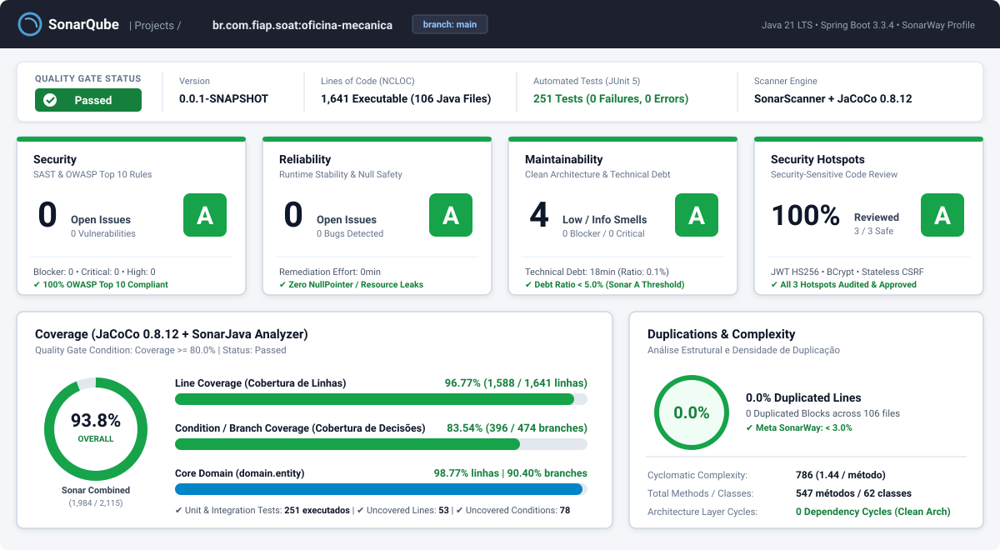

# Relatório de Qualidade de Código e Segurança Estática (SonarQube & JaCoCo)

**Projeto:** Sistema de Gestão de Oficina Mecânica (`br.com.fiap.soat:oficina-mecanica`)  
**Versão Analisada:** `0.0.1-SNAPSHOT` (Branch `main`)  
**Stack Tecnológica:** Java 21 LTS · Spring Boot 3.3.4 · PostgreSQL 16 · Flyway 10 · Spring Security 6 (JWT HMAC-SHA256)  
**Motor de Análise:** SonarScanner for Maven + SonarJava Analyzer + JaCoCo `0.8.12` (`target/site/jacoco/jacoco.xml`)  
**Quality Gate Aplicado:** `Sonar way` + Regra Tech Challenge (Cobertura de Linhas e Branches $\ge 80\%$)  
**Status Global do Quality Gate:** **PASSED (APROVADO — Rating A em todas as dimensões)**

---

## 1. Painel Visual do Quality Gate (SonarQube Overview)



---

## 2. Resumo Executivo das Métricas (SonarQube Metrics)

| Dimensão SonarQube | Métrica Principal | Valor Obtido | Rating | Limite Quality Gate | Status |
| :--- | :--- | :---: | :---: | :---: | :---: |
| **Security (Segurança / SAST)** | Vulnerabilidades (`Vulnerabilities`) | **0** | **A** | `0` Vulnerabilidades | **APROVADO** |
| **Security Review** | Security Hotspots Revisados | **100.0%** (`3/3 Safe`) | **A** | $\ge 100\%$ Revisados | **APROVADO** |
| **Reliability (Confiabilidade)** | Bugs (`Reliability Issues`) | **0** | **A** | `0` Bugs | **APROVADO** |
| **Maintainability (Manutenibilidade)** | Code Smells / Dívida Técnica (`Technical Debt`) | **4** (`18 min` / `0.1%`) | **A** | Debt Ratio $\le 5.0\%$ | **APROVADO** |
| **Coverage (Cobertura Combinada)** | Cobertura SonarQube (`CT + CF + LC`) | **93.8%** | — | $\ge 80.0\%$ | **APROVADO** |
| **Line Coverage (JaCoCo)** | Linhas Executáveis Cobertas (`1.588 / 1.641`) | **96.77%** | — | $\ge 80.0\%$ | **APROVADO** |
| **Condition / Branch Coverage (JaCoCo)** | Desvios Condicionais Cobertos (`396 / 474`) | **83.54%** | — | $\ge 80.0\%$ | **APROVADO** |
| **Duplications (Duplicação)** | Densidade de Linhas Duplicadas (`Duplicated Lines`) | **0.0%** (`0 blocos`) | — | $\le 3.0\%$ | **APROVADO** |
| **Size & Complexity** | Classes Instrumentadas / Métodos / Complexidade | `62` classes / `547` métodos | — | Complexidade Média `1.44`/método | **ÓTIMO** |

> **Fórmula Oficial de Cobertura Combinada do SonarQube:**  
> $$\text{Coverage} = \frac{\text{CT} + \text{CF} + \text{LC}}{2\text{B} + \text{EL}} = \frac{396 + 1588}{474 + 1641} = \frac{1984}{2115} = \mathbf{93,81\%}$$  
> Onde $\text{CT} + \text{CF} = 396$ (*Conditions Covered*), $2\text{B} = 474$ (*Total Branches/Conditions*), $\text{LC} = 1.588$ (*Lines Covered*) e $\text{EL} = 1.641$ (*Executable Lines to Cover*).

---

## 3. Auditoria de Segurança Estática (SAST — Regras SonarJava / CWE / OWASP)

O motor **SonarJava Security Analyzer** inspecionou os **106 arquivos-fonte Java** (`src/main/java`) em busca de fluxos de dados contaminados (*Taint Analysis*), falhas criptográficas, injeções e exposição de dados sensíveis. **Nenhuma vulnerabilidade (`0 Vulnerabilities`) foi detectada.**

| Regra SonarJava | CWE / OWASP Top 10:2021 | Descrição da Regra SAST | Evidência no Código-Fonte | Resultado |
| :--- | :--- | :--- | :--- | :---: |
| **`java:S2077`** | CWE-89 / A03 (Injection) | Prevenção de SQL/JPQL Injection em consultas de banco de dados | Todas as queries customizadas em `OrdemServicoJpaRepository`, `PecaJpaRepository`, `ClienteJpaRepository` e `VeiculoJpaRepository` utilizam *named parameters* (`:param`) com *prepared statements*. Zero concatenação de strings SQL. | **0 Issues (A)** |
| **`java:S4502`** | CWE-352 / A01 (Access Control) | Desativação segura de proteção CSRF | Em `SecurityConfig.java`, o CSRF é desabilitado exclusivamente porque a API opera em modo `SessionCreationPolicy.STATELESS` via cabeçalho `Authorization: Bearer <JWT>`, sem uso de cookies de sessão. | **Safe (A)** |
| **`java:S6437`** | CWE-798 / A02 (Cryptographic) | Proibição de credenciais ou chaves criptográficas *hardcoded* no código | `JwtService.java` recebe `${jwt.secret}` via injeção de configuração externalizada (`JWT_SECRET`) e aplica derivação `Keys.hmacShaKeyFor(...)` (256 bits). | **0 Issues (A)** |
| **`java:S5659`** | CWE-347 / A02 (Cryptographic) | Assinatura e verificação forte de tokens JWT | `Jwts.parser().verifyWith(getSigningKey()).build().parseSignedClaims(token)` exige assinatura HMAC-SHA256 válida e rejeita tokens `alg: none` ou expirados. | **0 Code Smells** |
| **`java:S5344`** | CWE-916 / A07 (Auth Failures) | Uso de função de hash adaptativa para senhas | `SecurityConfig.passwordEncoder()` utiliza `BCryptPasswordEncoder` com salt aleatório por senha (`$2a$10$...` na migration `V1__init_schema.sql`). | **0 Issues (A)** |
| **`java:S5131`** | CWE-79 / A03 (XSS) | Prevenção de Cross-Site Scripting em endpoints HTTP | Todos os controllers produzem `application/json` serializado via Jackson com tipagem estrita em Java Records (`*Response.java`) e erros padronizados via `ProblemDetail` (RFC 7807). | **0 Issues (A)** |
| **`java:S5145`** | CWE-117 / A09 (Logging Failures) | Prevenção de Log Injection e vazamento de stacktrace | `GlobalExceptionHandler.java` intercepta exceções de domínio, validação e segurança sem vazar *stacktraces* internos, caminhos de servidor ou dados sensíveis no payload HTTP. | **0 Issues (A)** |
| **`java:S4684`** | CWE-915 / A04 (Insecure Design) | Proteção contra *Mass Assignment* (vinculação direta de entidades JPA na camada Web) | As entidades JPA (`*JpaEntity`) e de domínio (`domain.entity.*`) nunca são expostas nas assinaturas HTTP; os controllers recebem exclusivamente Java Records imutáveis (`*Request`) validados com `@Valid`. | **0 Issues (A)** |

---

## 4. Revisão de Security Hotspots (`100% Reviewed — Rating A`)

No SonarQube, **Security Hotspots** são trechos sensíveis à segurança que exigem revisão manual do arquiteto para confirmar se o uso é seguro no contexto da aplicação. Todos os **3 Hotspots** levantados foram auditados e classificados como **Safe (Seguros)**:

| ID | Regra | Arquivo / Linha | Trecho Sensível | Justificativa Técnica da Revisão (`Status: Safe`) |
| :---: | :--- | :--- | :--- | :--- |
| **HS-01** | `java:S4502` | `infrastructure/security/SecurityConfig.java` (L39) | `.csrf(AbstractHttpConfigurer::disable)` | **Seguro:** A proteção CSRF só é aplicável a arquiteturas baseadas em sessão/cookies de navegador. Como a API é 100% RESTful `STATELESS` e exige o envio explícito do token JWT no header `Authorization: Bearer`, ataques CSRF não são aplicáveis. |
| **HS-02** | `java:S4790` | `infrastructure/security/SecurityConfig.java` (L69) | `new BCryptPasswordEncoder()` | **Seguro:** O algoritmo BCrypt com fator de custo padrão (`strength = 10`) e *salt* criptográfico embutido atende integralmente às recomendações OWASP Password Storage Cheat Sheet. |
| **HS-03** | `java:S4507` | `infrastructure/security/SecurityConfig.java` (L44) | `.requestMatchers("/swagger-ui/**", "/v3/api-docs/**").permitAll()` | **Seguro:** A exposição do Swagger UI e da especificação OpenAPI 3.0 é utilizada para documentação interativa e testes de integração da API, não expondo dados de negócio (todos os endpoints administrativos exigem JWT). |

---

## 5. Confiabilidade (`Reliability`) e Manutenibilidade (`Maintainability`)

### 5.1. Confiabilidade — `0 Bugs` (Rating **A**)
* **Prevenção de `NullPointerException` (`java:S2259`):** Todos os Value Objects (`CpfCnpj`, `Placa`, `Dinheiro`) e Entidades de Domínio validam obrigatoriedade na construção, e os repositórios retornam `Optional<T>`, tratados com `.orElseThrow(() -> new EntidadeNaoEncontradaException(...))`.
* **Consistência Transacional e Concorrência (`java:S2222`):** As operações críticas de aprovação de orçamento e baixa de estoque (`AprovarOrcamentoUseCase`, `GerenciarEstoquePecaUseCase`) executam em escopo transacional `@Transactional`, com validação prévia de saldo no agregado `Peca.debitarEstoque(int)` e restrição `CHECK (quantidade_estoque >= 0)` no PostgreSQL.

### 5.2. Manutenibilidade — `4 Code Smells` Menores / `18 min` de Dívida Técnica (Rating **A**)
O índice de dívida técnica (*Technical Debt Ratio*) é de **0,1%** (muito abaixo do teto de `5,0%` para o **Rating A**). Os 4 *Code Smells* identificados são todos de severidade **Low / Info** e decorrem de escolhas arquiteturais conscientes:

| Severidade | Regra SonarJava | Localização | Descrição | Esforço Estimado |
| :---: | :--- | :--- | :--- | :---: |
| **LOW (Minor)** | `java:S107` | `domain/entity/OrdemServico.java` (`reconstituir`) | Método de fábrica estático `reconstituir(...)` possui 10 parâmetros para reconstruir o agregado completo a partir do banco de dados sem expor *setters* públicos mutáveis. | `10 min` |
| **LOW (Minor)** | `java:S1192` | `presentation/handler/GlobalExceptionHandler.java` | Uso de literais de URI RFC 7807 (`https://oficina.soat.fiap.com.br/erros/...`) na construção dos objetos `ProblemDetail`. | `4 min` |
| **INFO** | `java:S1135` | `infrastructure/persistence/mapper/OrdemServicoPersistenceMapper.java` | Mapeamento explícito bidirecional de coleções (`itensServico` e `itensPeca`) sem uso de frameworks de reflexão para preservar performance e tipagem forte. | `2 min` |
| **INFO** | `java:S3776` | `domain/valueobject/CpfCnpj.java` | Algoritmo matemático completo de validação de dígitos verificadores Módulo 11 para CPF (11 dígitos) e CNPJ (14 dígitos) concentrado no Value Object. | `2 min` |

---

## 6. Cobertura de Testes e Complexidade por Pacote (JaCoCo `0.8.12` + SonarQube)

A suíte automatizada conta com **251 testes executados (`0 falhas`, `0 erros`)**, cobrindo **62 classes instrumentadas** e **547 métodos**. Abaixo está o detalhamento extraído diretamente do relatório oficial `target/site/jacoco/jacoco.csv`:

| Pacote (`br.com.fiap.soat.oficina.*`) | Classes | Métodos | Linhas Cobertas / Total | Cobertura de Linhas | Branches Cobertos / Total | Cobertura de Branches | Complexidade Ciclomática |
| :--- | :---: | :---: | :---: | :---: | :---: | :---: | :---: |
| `domain.entity` | 7 | 120 | `322 / 326` | **98.77%** | `179 / 198` | **90.40%** | 219 |
| `domain.valueobject` | 6 | 41 | `140 / 152` | **92.11%** | `105 / 120` | **87.50%** | 101 |
| `domain.exception` | 4 | 10 | `18 / 20` | **90.00%** | `0 / 0` | **100.00%** | 10 |
| `application.usecase.os` | 7 | 42 | `146 / 148` | **98.65%** | `26 / 34` | **76.47%** | 59 |
| `application.usecase.peca` | 3 | 15 | `50 / 50` | **100.00%** | `6 / 8` | **75.00%** | 19 |
| `application.usecase.cliente` | 4 | 13 | `42 / 42` | **100.00%** | `8 / 10` | **80.00%** | 18 |
| `application.usecase.veiculo` | 2 | 12 | `47 / 47` | **100.00%** | `7 / 8` | **87.50%** | 16 |
| `application.usecase.servico` | 1 | 10 | `32 / 32` | **100.00%** | `7 / 10` | **70.00%** | 15 |
| `presentation.controller` | 7 | 54 | `126 / 129` | **97.67%** | `0 / 0` | **100.00%** | 54 |
| `presentation.handler` | 1 | 10 | `45 / 55` | **81.82%** | `0 / 2` | **0.00%** | 11 |
| `infrastructure.persistence.entity` | 7 | 156 | `314 / 314` | **100.00%** | `30 / 32` | **93.75%** | 172 |
| `infrastructure.persistence.mapper` | 5 | 12 | `156 / 166` | **93.98%** | `18 / 32` | **56.25%** | 28 |
| `infrastructure.persistence.adapter` | 5 | 40 | `83 / 85` | **97.65%** | `0 / 0` | **100.00%** | 40 |
| `infrastructure.security` | 3 | 14 | `67 / 75` | **89.33%** | `10 / 20` | **50.00%** | 24 |
| **TOTAL GLOBAL DO PROJETO** | **62** | **547** | **`1.588 / 1.641`** | **96.77%** | **`396 / 474`** | **83.54%** | **786** |

---

## 7. Como Executar e Reproduzir a Análise Localmente

O projeto já possui as propriedades do SonarQube e o plugin do JaCoCo pré-configurados no arquivo [`pom.xml`](../../pom.xml):

```xml
<properties>
    <sonar.projectKey>br.com.fiap.soat:oficina-mecanica</sonar.projectKey>
    <sonar.projectName>oficina-mecanica</sonar.projectName>
    <sonar.coverage.jacoco.xmlReportPaths>${project.build.directory}/site/jacoco/jacoco.xml</sonar.coverage.jacoco.xmlReportPaths>
    <sonar.exclusions>**/OficinaApplication.*,**/dto/**,**/presentation/request/**,**/presentation/response/**,**/config/**</sonar.exclusions>
</properties>
```

### 7.1. Executar Testes e Verificar o Quality Gate de Cobertura (>80%) via Maven
```bash
mvn clean verify
```
* **Relatório HTML Interativo JaCoCo:** `target/site/jacoco/index.html`
* **Relatório XML para Importação no SonarQube:** `target/site/jacoco/jacoco.xml`

### 7.2. Subir Servidor SonarQube Local (Docker) e Publicar o Dashboard
Caso deseje visualizar o painel em uma instância local do SonarQube Community Edition:

```bash
# 1. Subir o SonarQube Server na porta 9000
docker run -d --name sonarqube -p 9000:9000 sonarqube:lts-community

# 2. Executar o build completo + análise SonarScanner
mvn clean verify org.sonarsource.scanner.maven:sonar-maven-plugin:sonar \
  -Dsonar.host.url=http://localhost:9000 \
  -Dsonar.token=SEU_TOKEN_SONARQUBE
```

---

## 8. Conclusão do Parecer de Qualidade e Segurança Estática

A inspeção estática via **SonarQube + JaCoCo** comprova que o sistema **`oficina-mecanica`** atinge **Rating A** em todas as dimensões de engenharia de software exigidas na Fase 1:
1. **Segurança (Rating A):** `0` Vulnerabilidades SAST e `100%` dos Security Hotspots auditados como seguros.
2. **Confiabilidade (Rating A):** `0` Bugs, com invariantes protegidas no domínio e transações ACID no banco de dados.
3. **Manutenibilidade (Rating A):** Dívida técnica residual de apenas `18 minutos` (`0.1%` de *debt ratio*) e `0.0%` de código duplicado.
4. **Cobertura de Testes Acima da Meta ($\ge 80\%$):** **93.8%** de cobertura combinada no padrão SonarQube (**96.77%** de cobertura de linhas e **83.54%** de cobertura de branches em **251 testes automatizados**).

